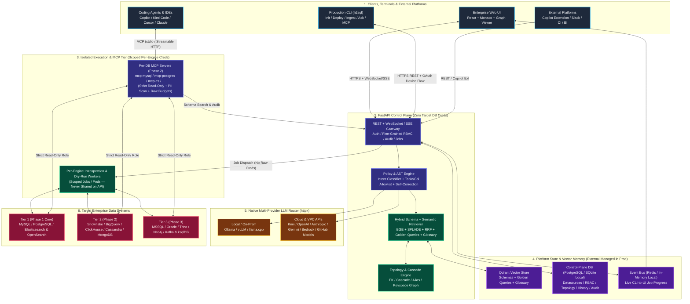
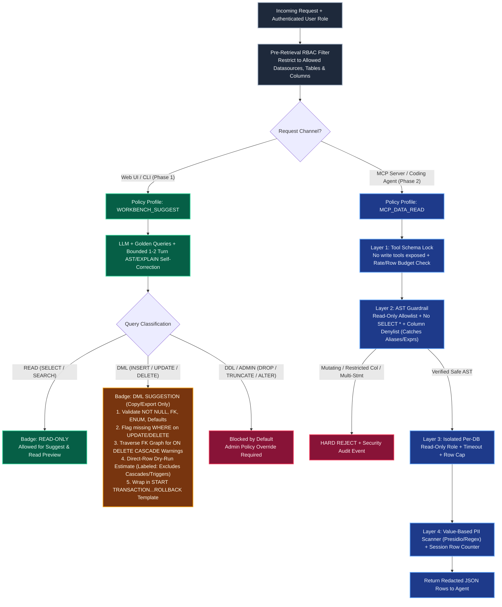
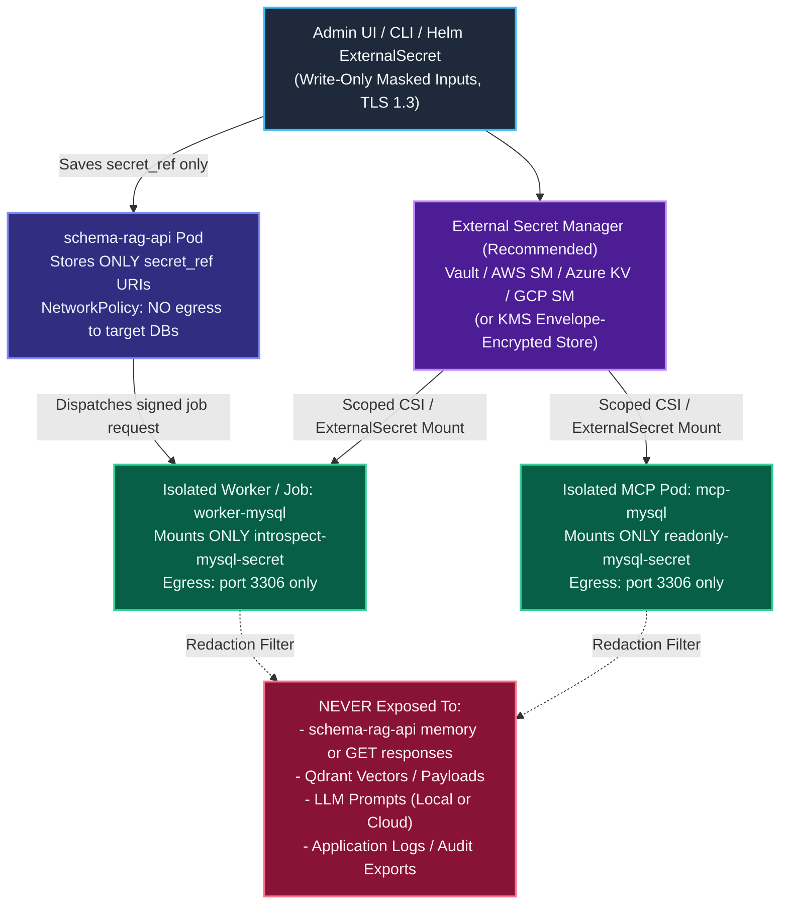
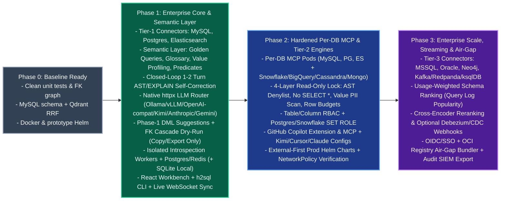

# Enterprise Platform Blueprint (v2 — Hardened): Multi-Engine Text-to-Query, AI Agent MCP & Production Deployment Plan

> [!NOTE]
> This revised blueprint evolves **human_to_sql** (`schema_rag/`, `portal.py`, `helm/schema-rag/`) into an **enterprise-ready, multi-engine natural-language-to-query platform**. It hardens the v1 design by tightening Phase-1 scope for high accuracy, promoting the **Semantic Layer** to Phase 1, isolating target database credentials away from the public API pod, enforcing **fine-grained table/column RBAC and anti-exfiltration controls** in Phase-2 MCP, and aligning Kubernetes deployment with enterprise infrastructure standards.

---

## 1. Executive Vision & Core Design Principles

Today, `human_to_sql` solves schema-level RAG for MySQL using Qdrant hybrid search (`BAAI/bge-small-en-v1.5` + `SPLADE`), a NetworkX foreign-key graph (`fk_graph.py`), and a local Ollama generator (`sql_generator.py`). To reach enterprise production without diluting query accuracy or security, the platform is built on six pillars:

1. **Depth-First Universal Engine Architecture**: One shared hybrid vector + topology RAG core with a pluggable `BaseConnector` SDK—shipping **Tier-1 engines first** (**MySQL, PostgreSQL/TimescaleDB, Elasticsearch/OpenSearch**) to prove relational and search/log paradigms end-to-end before expanding to Cloud Warehouses (Snowflake, BigQuery, Redshift, Databricks, ClickHouse, Trino), Wide-Column (Cassandra/ScyllaDB), Document (MongoDB), Graph (Neo4j), and Streaming (Kafka/Redpanda/ksqlDB).
2. **Phase-1 Semantic Layer & Closed-Loop Accuracy**: Enterprise schemas rarely succeed on raw DDL alone. Phase 1 includes a **Verified Golden Query Bank**, **Business Glossary**, **Mandatory Global Predicates** (soft deletes, tenant scoping), **Low-Cardinality Value Profiling**, and a **bounded 1–2 turn AST/`EXPLAIN` self-correction loop**.
3. **Provider-Agnostic Native LLM Gateway**: Lightweight native `httpx` adapters for **local/on-prem runtimes** (Ollama, vLLM, llama.cpp, LM Studio) and **cloud/VPC providers** (OpenAI-compatible/Kimi, Anthropic, Gemini, Azure OpenAI, AWS Bedrock, GitHub Models)—governed by workspace air-gap policies without heavy proxy dependencies.
4. **Two-Phase Security & Execution Model**:
   - **Phase 1 — Query Workbench & Suggestion Engine**: Generates **read queries** and **annotated DML suggestions** (`INSERT`, `UPDATE`, `DELETE`, `UPSERT`) with syntax validation, `WHERE`-clause checks, **FK cascade blast-radius warnings**, and dry-run previews—strictly **suggestion + copy/export only** in v1 (never auto-executing writes).
   - **Phase 2 — Hardened Read-Only MCP Data Bridge**: Connects GitHub Copilot, Kimi Code, Claude Code, Cursor, and Antigravity via **Model Context Protocol (MCP)** with **four enforcement layers**: zero write tools, AST read-only + column-denylist validation, value-based PII scanning + session row budgets, and isolated per-DB read-only credentials + Kubernetes `NetworkPolicy`.
5. **Zero-Trust Credential Isolation**: Public-facing `schema-rag-api` **never holds raw target database credentials**. Introspection and Phase-1 dry-runs execute inside isolated per-engine workers or scoped Jobs; Phase-2 MCP pods mount only their single engine's read-only secret.
6. **Production CLI (`h2sql`), Enterprise Workbench & External-First Helm**: A React/TypeScript/Monaco/React Flow workbench synced in real time with `h2sql`, backed by Helm charts that default to **external managed Postgres/Redis/Qdrant** in production (with in-chart StatefulSets for local/E2E profiles) and **OCI registry mirroring** for air-gapped environments.

---

## 2. Target Enterprise System Architecture



---

## 3. Phase-1 Semantic Layer, Self-Correction & DML Policy

### A. Phase-1 Semantic Layer & Value Grounding (Mandatory for Production Accuracy)

Schema DDL alone leaves LLMs guessing business definitions, status codes, and mandatory filters. Phase 1 indexes four context layers per datasource:

1. **Verified Golden Query Bank (Few-Shot Store)**:
   - Store 20–50 human-verified `(question, canonical_query, explanation, tags)` examples per datasource in Qdrant alongside schema vectors.
   - At query time, retrieve the top-3 closest verified examples to anchor join paths, date conventions, and aggregations.
2. **Business Glossary & Metric Definitions**:
   - Map organization-specific concepts (`"ARR"`, `"active customer"`, `"net revenue"`, `"churned account"`) to explicit column formulas and table filters stored in `postgres-meta` and retrieved semantically.
3. **Mandatory Global Table Predicates**:
   - Define per-table policy rules (e.g., `orders.deleted_at IS NULL`, `customers.is_test_account = false`, or `tenant_id = :user_tenant_id`) that are both injected into the system prompt and verified/enforced at the AST layer.
4. **Low-Cardinality Value Profiling & Noise Filtering**:
   - During introspection, sample top-K (e.g., `<= 25`) distinct values for non-PII `VARCHAR`/status/category columns (e.g., `customer_segments.name -> ['VIP', 'Enterprise', 'Standard']`) so the LLM never hallucinates filter literals.
   - Support **table include/exclude regexes** (`exclude: ["*_bak_*", "tmp_*", "*_archive_*"]`) and **usage-weighted ranking** (using `pg_stat_user_tables` / warehouse query logs in Phase 2/3) so dead backup tables do not outrank production tables in 1,000+ table schemas.

### B. Bounded Closed-Loop Self-Correction

Instead of single-shot generation, the query pipeline runs a bounded **1–2 turn self-correction loop**:
1. Generate candidate query with dialect rules + Golden Queries + Semantic Glossary.
2. Parse with engine AST validator (`sqlglot` / ES DSL validator) and optionally run read-only `EXPLAIN` via the isolated engine worker.
3. If a syntax error, unknown column, or missing partition-key error occurs, feed the **exact error message** back to the LLM (max 2 retries) before returning the result to the user.

### C. Phase-1 DML Suggestions vs. Phase-2 Read-Only MCP Policy

> [!IMPORTANT]
> - **Phase 1 (Workbench / CLI)**: Generates read queries and **DML suggestions (`INSERT`, `UPDATE`, `DELETE`, `UPSERT`) as suggestion + dry-run preview + copy/export only**. No in-app write execution button exists in v1, avoiding write-credential liability and approval-workflow sprawl.
> - **Phase 2 (MCP Data Retrieval)**: All DML, DDL, and mutating operations are **strictly blocked** across four independent layers, plus table/column allowlists, value-based PII scanning, and per-session row budgets.



### Detailed Design for Phase-1 DML & Cascade-Aware Dry-Run

1. **Write-Aware Introspection**: Index `COLUMN_DEFAULT`, `EXTRA` (`auto_increment`, `DEFAULT_GENERATED`), `IS_NULLABLE`, `ENUM(...)`, `CHECK`, `UNIQUE`, and **`ON DELETE` / `ON UPDATE` FK referential actions**.
2. **Cascade-Aware Dry-Run Enrichment**:
   - For simple single-table `UPDATE`/`DELETE`, synthesize a safe `SELECT COUNT(*) AS direct_target_rows` preview via the isolated read worker.
   - **Cascade & Join Guard**: Traverse the persisted FK topology graph for any `ON DELETE CASCADE` child tables and surface explicit warnings (e.g., `["WARNING: Deleting from orders cascades to order_items and shipments via ON DELETE CASCADE"]`). Always label the estimate as **"Direct target rows (excludes cascades, triggers, and multi-table side effects)"**.
   - For multi-table `UPDATE ... JOIN` / `DELETE ... USING`, skip naive `COUNT(*)` synthesis if ambiguous and show a structural blast-radius warning instead of a misleading number.

---

## 4. Phased Multi-Engine Support & Rollout Strategy

Rather than building 6+ engines in parallel during Phase 1, engines roll out in **3 disciplined tiers** behind a unified `BaseConnector` interface.

| Tier / Phase | Supported Systems | Query Language | Introspection & Special Handling | Phase-2 MCP Lock |
|---|---|---|---|---|
| **Tier 1 (Phase 1 Core)** | **MySQL 8+**, **MariaDB** | MySQL SQL | `information_schema` + FK actions + low-cardinality value profiling | `sqlglot(mysql)` allowlist, `MAX_EXECUTION_TIME`, read-only user |
| **Tier 1 (Phase 1 Core)** | **PostgreSQL 16+**, **Aurora PG**, **TimescaleDB** | PostgreSQL SQL | `information_schema` + `pg_catalog` (schemas, materialized views, `JSONB`, partitions) + `pg_stat_user_tables` usage hints | `sqlglot(postgres)` allowlist, `default_transaction_read_only=on`, optional `SET ROLE` |
| **Tier 1 (Phase 1 Core)** | **Elasticsearch 8+**, **OpenSearch** | **ES\|QL**, **PPL**, **Query DSL** | `/_cat/indices`, `/_alias`, `/_data_stream`, `/_mapping` with field-group sub-chunking for 200+ field mappings | `/_search`, `/_count`, `/_esql` only; blocks `_update_by_query`, `_delete_by_query`, scripts |
| **Tier 2 (Phase 2)** | **Snowflake**, **BigQuery**, **Redshift**, **Databricks SQL**, **ClickHouse**, **Trino** | Dialect SQL | `INFORMATION_SCHEMA` / `ACCOUNT_USAGE` / Unity Catalog + query-log popularity ranking + `QUERY_TAG` FinOps attribution | Pre-flight cost/scan checks (`BigQuery dry_run`, `Snowflake EXPLAIN` partition stats) + byte/row caps |
| **Tier 2 (Phase 2)** | **Apache Cassandra**, **ScyllaDB** | **CQL** | `system_schema` (`partition_key`, `clustering_order`, SAI/secondary indexes) | Partition-key required in `WHERE`; blocks `ALLOW FILTERING`, `BATCH`, `TRUNCATE` |
| **Tier 2 (Phase 2)** | **MongoDB** | **MQL** | `listCollections`, `listIndexes`, `$sample` schema inference, `$jsonSchema` | Pipeline stage allowlist; blocks `$out`, `$merge`, `$where`, `$function` |
| **Tier 3 (Phase 3)** | **MSSQL**, **Oracle**, **DuckDB**, **SQLite**, **Neo4j**, **Apache Kafka / Redpanda / ksqlDB** | T-SQL / Oracle / Cypher / Kafka CLI & ksqlDB | Catalogs, `db.schema.visualization()`, Kafka AdminClient + Schema Registry (Avro/Protobuf/JSON) | Read-only sessions (`ACCESS_MODE_READ` in Neo4j); bounded timestamp/partition-scoped Kafka peek & pull-only ksqlDB |

> [!TIP]
> **Schema Drift Sync**: Default to **scheduled incremental hash-diff polling** (every 15–60 minutes per datasource) via isolated introspection workers. Reserve Kafka CDC / Debezium DDL webhooks as an optional Phase-3 add-on for teams that already operate Debezium.

---

## 5. Multi-Provider LLM Gateway & External Platform Integrations

### A. Lightweight Native `httpx` Adapter Architecture (No `litellm` Bloat)

To keep dependencies minimal, predictable, and easy to audit in air-gapped environments, the LLM router uses thin native `httpx` adapters behind a single `LLMProvider` interface:

| Adapter Class | Covered Providers | Connection Protocol | Enterprise Policy Controls |
|---|---|---|---|
| **`OllamaProvider`** | Ollama (CPU/GPU) | Local REST (`/api/chat`) | Allowed in `STRICT_ON_PREM` & air-gapped mode; zero external egress |
| **`OpenAICompatProvider`** | vLLM, llama.cpp, LM Studio, **Kimi (Moonshot)**, OpenAI, Groq, DeepSeek, **GitHub Models / Azure AI Inference**, internal corporate gateways | `/v1/chat/completions` + custom base URL & auth headers / mTLS | Covers 80%+ of local, cloud, and internal gateways with one battle-tested adapter |
| **`AnthropicProvider`** | Anthropic Claude | Messages API (`/v1/messages`) | Encrypted key via Vault/KMS; optional schema-identifier redaction |
| **`GeminiVertexProvider`** | Google Gemini / Vertex AI | Gemini REST / Vertex IAM | Keeps inference inside GCP VPC perimeter |
| **`BedrockProvider`** | AWS Bedrock | IAM / PrivateLink (`boto3`/SigV4) | Keeps inference inside AWS VPC perimeter |
| **`CustomPluginProvider`** | Proprietary REST APIs | Jinja2 `request_template` + `response_jsonpath` or `h2sql.providers` Python entry point | Supports custom headers (`x-corp-token`) and internal mTLS |

### B. Compliant Coding-Agent & GitHub Copilot Integrations

1. **GitHub Copilot Enterprise / Business (Two Officially Supported Paths)**:
   - **IDE & Chat Integration (Recommended)**: Developers connect Copilot Agent Mode in VS Code/JetBrains to `h2sql` per-DB MCP servers (`.vscode/mcp.json` / org MCP allowlist), or invoke the **`@h2sql` GitHub Copilot Extension** (`/integrations/copilot-extension`), where GitHub invokes your service with a request-scoped Copilot token.
   - **Backend LLM API Routing**: Use **GitHub Models / Azure AI Inference** with an organization-provisioned API token—**never** scrape or proxy personal/org Copilot seat tokens from a third-party backend via OAuth Device Flow, which violates GitHub Copilot Terms of Service.
2. **MCP Transport for Coding Agents (Phase 2)**:
   - **Local (`stdio`)**: `h2sql mcp --engine mysql --source dev-mysql`.
   - **Remote Enterprise (`Streamable HTTP` + OIDC/JWT)**: `https://h2sql.corp.internal/mcp/<engine>` with per-user role enforcement.
3. **OpenAI-Compatible Gateway (`/v1/chat/completions`) & SSE API (`/api/v1/query/stream`)**:
   - Streams structured progress stages: `retrieving_schema` -> `retrieving_golden_queries` -> `generating_query` -> `self_correcting` -> `validating_safety` -> `dry_run_estimate`.

---

## 6. Enterprise UI Workbench Design

Replacing portal.html with a modular **React + TypeScript + Tailwind + Monaco Editor + React Flow** workbench:

- **Top Control Bar**: Datasource switcher (engine badge + `DEV`/`STAGING`/`PROD` tag), Model/Provider picker (Local vs. Cloud + on-prem compliance badge), and active Policy Mode badge (`Phase 1: Read + DML Suggest` vs. `Phase 2: MCP Read-Only`).
- **Split Workbench**:
  - **Left Pane**: Searchable Schema & Topology Explorer (filtered by user RBAC—restricted tables hidden) + interactive React Flow ER/alias graph showing seed matches, topology expansions, and `ON DELETE CASCADE` edges.
  - **Center Pane**: Multi-turn prompt box, Monaco Editor with Risk Banner (`READ-ONLY`, `DML SUGGESTION — Copy/Export Only`, `DDL BLOCKED`), **Cascade-Aware Dry-Run Card**, and read-only result table/chart preview.
  - **Right Drawer**: Provenance inspector (RRF scores, retrieved Golden Queries, Glossary terms applied, self-correction trace, token count) and live CLI/UI Indexing Progress stream.
- **Admin Console (Phase 1 Core)**: Datasource management (write-only masked credentials), **Golden Query Bank & Business Glossary editor**, Table/Column RBAC allowlist matrix, mandatory predicate rules, and immutable audit log viewer.

---

## 7. Production Helm Charts & Infrastructure Plan

### A. External-First Production Topology

Enterprise Kubernetes platform teams prefer managed databases over app-chart StatefulSets. `values.yaml` treats **external managed PostgreSQL, Redis, and Qdrant** as first-class production defaults, while keeping in-chart StatefulSets enabled in `values-local.yaml` and `values-e2e-test.yaml`.

```yaml
# values.yaml (Production Default)
externalPostgres:
  enabled: true
  existingSecret: "h2sql-postgres-meta-secret"
externalRedis:
  enabled: true
  existingSecret: "h2sql-redis-secret"
externalQdrant:
  enabled: true
  url: "https://qdrant.platform.svc.cluster.local:6333"

# Optional in-chart e2e-sandbox (false in prod; true in values-e2e-test.yaml)
e2eSandbox:
  enabled: false
  mysql:         { enabled: true }
  postgres:      { enabled: true }
  elasticsearch: { enabled: true }
  # Tier-2/3 engines enabled selectively when testing Phase 2/3 profiles
  cassandra:     { enabled: false }
  mongodb:       { enabled: false }
  neo4j:         { enabled: false }
  kafka:         { enabled: false, mode: "redpanda" }
```

### B. Target Helm Chart Structure & Zero-Trust NetworkPolicies

```text
helm/schema-rag/
├── Chart.yaml
├── values.yaml                  # Prod HA: external PG/Redis/Qdrant, TLS, OIDC, NetworkPolicies
├── values-local.yaml            # kind / minikube / Docker Desktop (in-chart PG/Redis/Qdrant)
├── values-e2e-test.yaml         # Enables e2e-sandbox Tier-1/2/3 DBs + seed Jobs
├── values-airgap.yaml           # OCI mirror registry, offline model PVC, zero internet egress
├── charts/e2e-sandbox/          # Optional test DB subchart (disabled in prod)
└── templates/
    ├── deployment-ui.yaml       # React Workbench (HPA, PDB)
    ├── deployment-api.yaml      # Control Plane API (HPA, PDB — NO target DB secrets mounted!)
    ├── deployment-worker.yaml   # Range-loop per-engine Introspection & Dry-Run Workers
    ├── deployment-mcp.yaml      # Range-loop per-DB MCP Pods (dedicated SA + single RO Secret)
    ├── externalsecret.yaml      # Vault / AWS SM / Azure KV / GCP SM integration
    ├── networkpolicy.yaml       # Strict pod isolation (API cannot reach target DBs directly!)
    ├── ingress.yaml             # TLS + OIDC routing (/, /api, /ws, /mcp/<engine>)
    ├── job-migrate.yaml         # Alembic DB migrations
    └── tests/test-e2e-smoke.yaml
```

### C. Air-Gapped Delivery via OCI Registry Mirroring

Instead of brittle monolithic `.tar.gz` tarballs across `amd64`/`arm64` and CUDA variants, air-gapped delivery uses an **OCI Registry Bundle** (`h2sql bundle --oci-dir ./airgap-bundle`):
- Packages Helm chart, multi-arch container images (`skopeo` / `oras` / Zarf-compatible manifest), and pinned HuggingFace/GGUF model artifacts with SHA-256 digests so enterprises mirror cleanly into Harbor, Artifactory, or ECR.

### D. Hardware Specifications

| Helm Values Profile | What Runs | CPU | RAM | Storage | GPU |
|---|---|---|---|---|---|
| **`values-local.yaml`** | API + UI + in-chart PG/Redis/Qdrant + Tier-1 DBs (MySQL, PG) + `gemma2:2b` or Cloud LLM | 4–6 vCPU | 16 GB | 35 GB SSD | None |
| **`values-e2e-test.yaml`** *(Tier-1 Core)* | Control Plane + Workers + 3 MCP pods + MySQL, PG, ES + `gemma2:2b` / Replay Stub | 6–8 vCPU | 20–24 GB | 60 GB NVMe | None |
| **`values-e2e-test.yaml`** *(Full Multi-Engine)* | All 7 engines + 7 MCP pods + Control Plane + `7B` local LLM (or Cloud LLM) | 12–16 vCPU | 32–64 GB | 120 GB NVMe | Optional 16 GB VRAM |
| **`values.yaml`** *(Prod HA + Cloud/VPC LLM)* | 2+ API/UI replicas, Workers, Per-DB MCP pods (external PG/Redis/Qdrant) | 8 vCPU | 24–32 GB | 50 GB SSD | None |
| **`values.yaml`** *(Prod HA + Local vLLM)* | Same HA Control Plane + vLLM (`14B–32B`) | 16 vCPU | 64 GB | 200 GB NVMe | 1× L4/A10G (24 GB VRAM) |

---

## 8. Hardened Per-Database MCP Architecture (Phase 2)

### A. Credentials-Only Client Onboarding ("Zero Wiring")

Clients provide **only database credentials** (via `ExternalSecret`, Helm, CLI, or Admin UI) plus optional **table/column allowlists**. The platform auto-wires introspection, Qdrant indexing, per-DB MCP pod deployment, 4-layer read-only guardrails, and generates ready-to-paste `.vscode/mcp.json` / agent configs.

### B. Four-Layer Defense-in-Depth & Anti-Exfiltration Controls

| Security Layer | Enforcement Mechanism | Threat Mitigated |
|---|---|---|
| **Layer 1: Tool & Budget Lock** | Expose read-only tools only (`search_schema`, `explain_query`, `run_<engine>_query`). Enforce **per-session & hourly cumulative row budgets** (e.g., max 1,000 rows/hour per user) and rate limits. | Write tool abuse; automated pagination scraping / bulk table exfiltration by compromised agents. |
| **Layer 2: AST & Fine-Grained RBAC Guard** | Engine-specific AST parser (`sqlglot` / CQL / ES DSL / MQL / Cypher) enforces: (a) read-only statement allowlist, (b) **no `SELECT *`** (explicit column projection required), (c) **table/column allowlist & PII column denylist** checked across all AST nodes (catching aliases like `SELECT email AS x` and expressions like `CONCAT(phone, '')`), and (d) mandatory global predicates. | SQL injection, comment bypasses, multi-statement piggybacking, and PII column alias evasion. |
| **Layer 3: Isolated DB Role & Quotas** | Dedicated per-DB `mcp-<engine>` pod mounts only that engine's read-only secret. Enforces `SET SESSION TRANSACTION READ ONLY`, `statement_timeout <= 5s`, hard `LIMIT <= 100`, `QUERY_TAG` FinOps attribution, and optional Postgres/Snowflake **`SET ROLE <user_role>`** impersonation. | Application-layer bugs; runaway scans; cross-tenant visibility. |
| **Layer 4: Value-Based PII Redaction & Prompt-Injection Hygiene** | Scan returned cell values with content-based PII detectors (Presidio / regex for emails, SSNs, cards, bearer tokens) independent of column names. Wrap untrusted DB string values in structured JSON envelopes with clear data-vs-instruction boundaries and log every query + row count to immutable audit storage. | PII hidden in free-text `notes` columns; indirect prompt injection from user-generated DB rows. |

### C. Per-Database MCP Package Layout

```text
schema_rag/mcp_servers/
├── core/
│   ├── base_server.py       # Official Python MCP SDK wrapper (stdio + Streamable HTTP)
│   ├── auth.py              # OIDC/JWT validation, table/column RBAC policy enforcement
│   ├── policy.py            # AST read-only lock, no-SELECT-*, column denylist, row budgets
│   ├── pii_redactor.py      # Value-based PII scanner (Presidio/regex) on result payloads
│   └── audit.py             # Immutable audit log + anomaly alerting
└── engines/
    ├── mysql_mcp.py         # Tier 1
    ├── postgres_mcp.py      # Tier 1 (with optional SET ROLE impersonation)
    ├── elasticsearch_mcp.py # Tier 1
    ├── warehouse_mcp.py     # Tier 2 (Snowflake/BigQuery/ClickHouse cost & QUERY_TAG guard)
    ├── cassandra_mcp.py     # Tier 2 (partition-key guard, blocks ALLOW FILTERING)
    ├── mongodb_mcp.py       # Tier 2 (pipeline stage allowlist)
    ├── neo4j_mcp.py         # Tier 3 (ACCESS_MODE_READ)
    └── kafka_mcp.py         # Tier 3 (bounded timestamp/partition peek, read-only ksqlDB)
```

---

## 9. Zero-Trust Credential Isolation (Eliminating API Blast Radius)

A key upgrade in v2 is removing target database credential decryption from the public-facing `schema-rag-api` pod:



- **Mode A (Production Recommended)**: Kubernetes `ExternalSecret` / CSI Driver mounts credentials directly into `worker-<engine>` and `mcp-<engine>` pods; `postgres-meta` stores only `secret_ref` URIs.
- **Mode B (Standalone / Local)**: AES-256-GCM envelope encryption (per-secret DEK wrapped by KMS/K8s KEK) decrypted only inside the scoped worker process.

---

## 10. Phased Implementation Roadmap & Locked Decisions



### Locked Architectural Decisions (Resolved from v1)

| Decision Area | Locked Choice | Rationale |
|---|---|---|
| **1. First Connector Batch** | **MySQL + PostgreSQL + Elasticsearch** (Tier 1) | Proves `BaseConnector` across 2 distinct paradigms (Relational + Search/Logs) while maintaining >=90% accuracy before expanding to Tier 2/3. |
| **2. Metadata Store & Event Bus** | **PostgreSQL + Redis** in Prod (external managed default in Helm), **SQLite + in-memory pub/sub** for local single-user CLI | Enterprise HA in Kubernetes with zero-friction 30-second local developer onboarding. |
| **3. Phase-1 DML Behavior** | **Suggestion + Cascade-Aware Dry-Run Preview + Copy/Export Only** | Eliminates write-credential exposure, approval workflow complexity, and production mutation liability in v1. |
| **4. LLM Gateway Strategy** | **Lightweight native `httpx` adapters** | Avoids heavy `litellm` dependency churn and simplifies air-gapped security audits; `OpenAICompatProvider` covers vLLM, Kimi, OpenAI, Groq, and GitHub Models. |
| **5. GitHub Copilot Integration** | **GitHub Models (API) + Copilot Extension / MCP (IDE)** | Fully TOS-compliant; avoids proxying personal/org Copilot seat tokens through a backend. |
