# Enterprise Platform Blueprint: Multi-Engine Text-to-Query, AI Agent MCP & Production Deployment Plan

> [!NOTE]
> This blueprint maps the evolution of **human_to_sql** from its current single-database prototype (`schema_rag/`, `portal.py`, `helm/schema-rag/`) into an **enterprise-grade, multi-engine natural-language-to-query platform** supporting SQL databases, NoSQL/wide-column/search engines, Apache Kafka, local and cloud LLM providers, a modern workbench UI, a production deployment CLI, and strict **Phase-1 DML Suggestions** vs. **Phase-2 Read-Only MCP Data Access**.

---

## 1. Executive Vision & Core Design Principles

Today, `human_to_sql` solves schema-level RAG for MySQL using Qdrant hybrid search (`BAAI/bge-small-en-v1.5` + `SPLADE`), a NetworkX foreign-key graph (`fk_graph.py`), and a local Ollama generator (`sql_generator.py`). To scale to enterprise production, the platform must evolve around five pillars:

1. **Universal Engine Support**: One shared hybrid vector + topology RAG core with pluggable connectors across **7 engine families (20+ systems)**:
   - **Relational OLTP**: MySQL, MariaDB, PostgreSQL, TimescaleDB, Microsoft SQL Server (MSSQL), Oracle, SQLite
   - **Cloud Warehouses & OLAP**: Snowflake, Google BigQuery, Amazon Redshift, Databricks SQL, ClickHouse, Trino / Presto, DuckDB
   - **Wide-Column NoSQL**: Apache Cassandra, ScyllaDB
   - **Search & Analytics**: Elasticsearch, OpenSearch
   - **Document Store**: MongoDB
   - **Graph Database**: Neo4j
   - **Streaming & Event Bus**: Apache Kafka, Redpanda, Confluent Schema Registry, ksqlDB, Apache Flink SQL
2. **Provider-Agnostic LLM Gateway**: Seamless switching between **local/on-prem runtimes** (Ollama, vLLM, llama.cpp, LM Studio) and **cloud/coding providers** (Kimi/Moonshot, OpenAI, Anthropic, Gemini, Azure OpenAI, AWS Bedrock, Groq), governed by workspace VPC/air-gap policies.
3. **Two-Phase Security & Execution Model**:
   - **Phase 1 — Query Workbench & Suggestion Engine**: Generates **both** read queries (`SELECT`, CQL, ES DSL, Cypher) **and** DML/write suggestions (`INSERT`, `UPDATE`, `DELETE`, `UPSERT`, Kafka/ES write commands) with syntax validation, `WHERE`-clause safety checks, transaction wrapping, and dry-run impact estimates—**never blind auto-execution**.
   - **Phase 2 — MCP Live Data Bridge for Coding Agents**: Connects Kimi Code, Claude Code, Cursor, Antigravity, and external platforms via **Model Context Protocol (MCP)** to fetch live schema and sample/aggregated data, where **all `INSERT` / `UPDATE` / `DELETE` / DDL / mutating operations are strictly forbidden** across three independent enforcement layers.
4. **Enterprise Workbench UI & Agent-Ready APIs**: A rich React/TypeScript workbench with interactive schema/ER graphs, Monaco query editor, live indexing telemetry, SSO/RBAC, and audit logs—paired with OpenAI-compatible REST, SSE streaming, and MCP endpoints.
5. **Production CLI (`h2sql`) & Real-Time Terminal ↔ UI Sync**: A single CLI to bundle (including air-gapped offline tarballs), deploy (Docker/Helm), ingest schemas, and control the running Control Plane—with live job progress, auth sessions, and query handoffs synced in real time to the Web UI.

---

## 2. Target Enterprise System Architecture

```mermaid
flowchart TB
    classDef client fill:#1e293b,stroke:#38bdf8,stroke-width:2px,color:#f8fafc
    classDef gateway fill:#312e81,stroke:#818cf8,stroke-width:2px,color:#eef2ff
    classDef core fill:#064e3b,stroke:#34d399,stroke-width:2px,color:#ecfdf5
    classDef store fill:#4c1d95,stroke:#c084fc,stroke-width:2px,color:#f5f3ff
    classDef llm fill:#78350f,stroke:#fbbf24,stroke-width:2px,color:#fffbeb
    classDef engine fill:#881337,stroke:#fb7185,stroke-width:2px,color:#fff1f2

    subgraph Clients["1. Clients, Terminals & External Platforms"]
        UI["Enterprise Web UI\nReact + Monaco + Graph Viewer"]:::client
        CLI["Production CLI (h2sql)\nInit / Bundle / Deploy / Ingest"]:::client
        MCPClient["Coding Agents\nKimi Code / Cursor / Claude / Antigravity"]:::client
        Apps["External Platforms\nSlack / Teams / CI / BI Tools"]:::client
    end

    subgraph ControlPlane["2. FastAPI Control Plane & Gateways"]
        API["REST + WebSocket / SSE Gateway\nAuth / RBAC / Audit / Jobs"]:::gateway
        MCPServer["MCP Server (Phase 2)\nstdio + Streamable HTTP (Strict Read-Only)"]:::gateway
        Policy["Policy & Safety Engine\nIntent Classifier + AST Validator + PII Masker"]:::gateway
    end

    subgraph Intelligence["3. Universal Schema-RAG Engine"]
        Retriever["Hybrid Retriever\nDense (BGE) + Sparse (SPLADE) + RRF + Reranker"]:::core
        GraphEngine["Topology & Relationship Engine\nFK / Keyspace / Alias / Topic Graph"]:::core
        PromptEngine["Dialect Prompt & Suggestion Engine\nPhase-1 Read + DML Suggestions"]:::core
        ConnectorMgr["Connector Registry\nPluggable Introspectors & Executors"]:::core
    end

    subgraph Storage["4. Platform State & Vector Memory"]
        Qdrant["Qdrant Vector Store\nPer-Datasource Collections + Payloads"]:::store
        MetaDB["Control-Plane DB (PostgreSQL / SQLite)\nDatasources / Providers / History / RBAC"]:::store
        EventBus["Event Bus (Redis / In-Memory)\nLive CLI-to-UI Job Progress"]:::store
    end

    subgraph Providers["5. Multi-Provider LLM Router"]
        LocalLLM["Local Runtimes\nOllama / vLLM / llama.cpp"]:::llm
        CloudLLM["Cloud & Agent APIs\nKimi / OpenAI / Anthropic / Gemini / Bedrock"]:::llm
    end

    subgraph DataSystems["6. Target Enterprise Data Systems"]
        RelDB["Relational & Warehouses\nMySQL / Postgres / Snowflake / BigQuery / ClickHouse"]:::engine
        WideCol["Wide-Column\nCassandra / ScyllaDB"]:::engine
        SearchDB["Search Engines\nElasticsearch / OpenSearch"]:::engine
        DocGraph["Document & Graph\nMongoDB / Neo4j"]:::engine
        KafkaSys["Streaming\nKafka / Schema Registry / ksqlDB"]:::engine
    end

    UI <-->|"HTTPS + WebSocket/SSE"| API
    CLI <-->|"HTTPS REST + OAuth Device Flow"| API
    Apps -->|"REST / Webhooks"| API
    MCPClient <-->|"MCP Protocol"| MCPServer

    API --> Policy
    MCPServer --> Policy
    Policy --> Retriever
    Policy --> PromptEngine
    Retriever <--> Qdrant
    Retriever <--> GraphEngine
    PromptEngine --> LocalLLM
    PromptEngine --> CloudLLM

    API <--> MetaDB
    API <--> EventBus
    EventBus --> UI
    ConnectorMgr <--> Qdrant
    ConnectorMgr <--> GraphEngine

    ConnectorMgr <--> RelDB
    ConnectorMgr <--> WideCol
    ConnectorMgr <--> SearchDB
    ConnectorMgr <--> DocGraph
    ConnectorMgr <--> KafkaSys
```

---

## 3. Phase-1 DML Suggestions vs. Phase-2 Read-Only MCP Policy

A critical architectural boundary separates **Phase 1 (Human Workbench & CLI)** from **Phase 2 (Autonomous Agent Data Retrieval via MCP)**.

> [!IMPORTANT]
> - **Phase 1 (Workbench / CLI)**: Users can ask for `SELECT` queries **and** write/DML queries (`INSERT`, `UPDATE`, `DELETE`, `UPSERT`, CQL `INSERT`, Elasticsearch document `POST`, Kafka produce templates). The platform generates these as **annotated, safety-checked suggestions**—never silently executing writes against production.
> - **Phase 2 (MCP Data Retrieval)**: When external coding agents (Kimi Code, Cursor, Claude Code, etc.) connect via MCP to **retrieve live data**, **all DML and DDL statements are blocked**. Only read-only queries (`SELECT`, `WITH`, `SHOW`, `EXPLAIN`, CQL `SELECT`, ES `_search`, Mongo `find`/`aggregate`, Kafka `--describe`/bounded peek) are permitted.

### Policy Enforcement Flow

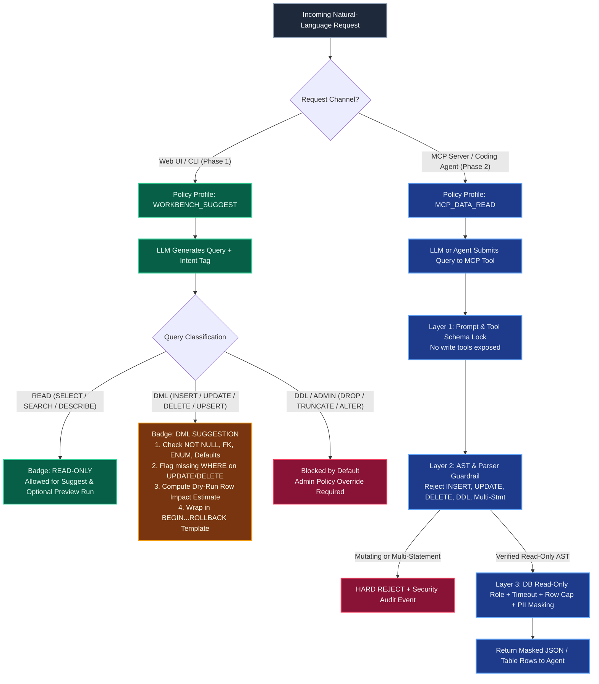

### Detailed Design for Phase-1 DML & `INSERT` Suggestions

Currently, [mysql_client.py](file:///home/chinmay/git_projects/human_to_sql/schema_rag/db/mysql_client.py) and [upsert.py](file:///home/chinmay/git_projects/human_to_sql/schema_rag/qdrant_store/upsert.py) omit several column attributes that are essential for accurate `INSERT` / `UPDATE` suggestions. In Phase 1, we enhance introspection and generation:

1. **Write-Aware Schema Metadata**:
   - Index `COLUMN_DEFAULT`, `EXTRA` (`auto_increment`, `DEFAULT_GENERATED`), `IS_NULLABLE`, `ENUM(...)` allowed values, `CHECK` constraints, `UNIQUE` constraints, and `ON DELETE` / `ON UPDATE` FK behaviors.
   - Example: If `orders.id` is `AUTO_INCREMENT` and `orders.created_at` has `DEFAULT CURRENT_TIMESTAMP`, the LLM knows not to invent fake `id` values in an `INSERT INTO orders (...) VALUES (...)` suggestion, and instead populates required `NOT NULL` foreign keys (`customer_id`) and valid `ENUM` literals.

2. **DML Safety & Impact Enrichment Object**:
   Instead of returning only `{"sql": "..."}`, the `/query` API returns structured suggestion metadata:
   - `intent`: `"read"` | `"dml_insert"` | `"dml_update"` | `"dml_delete"` | `"ddl_blocked"`
   - `executable_in_app`: `true` only for `"read"` (in Phase 1 read-preview)
   - `safety_warnings`: e.g., `["UPDATE has no WHERE clause", "References foreign key customers.id"]`
   - `dry_run_preview_sql`: e.g., for `DELETE FROM orders WHERE status = 'cancelled' AND created_at < '2024-01-01'`, the backend automatically synthesizes a safe read-only preview query `SELECT COUNT(*) AS affected_rows FROM orders WHERE status = 'cancelled' AND created_at < '2024-01-01'` so the engineer can verify blast radius before running the suggested DML externally.
   - `transaction_wrapper`: Optional `START TRANSACTION; <DML>; -- Verify row count before COMMIT;` wrapper in the UI copy-box.

3. **Multi-Engine DML Suggestion Examples**:
   - **MySQL / PostgreSQL**: `INSERT INTO ... (col1, col2) VALUES (...)`, `INSERT ... ON DUPLICATE KEY UPDATE` / `ON CONFLICT DO UPDATE`.
   - **Cassandra**: `INSERT INTO keyspace.table (partition_key, clustering_key, val) VALUES (...) IF NOT EXISTS;` (explicitly warning about upsert semantics in CQL).
   - **Elasticsearch**: `POST /orders/_doc { ... }` or `POST /orders/_update_by_query` suggestion templates with mapping-validated field names.
   - **MongoDB**: `db.orders.insertOne({ ... })` / `db.orders.updateMany({ filter }, { $set: { ... } })`.
   - **Kafka**: `kcat -P -b <broker> -t <topic>` with an Avro/JSON payload template matching the Schema Registry schema.

---

## 4. Universal Multi-Engine Support & Complete Database List

To support SQL databases, data warehouses, NoSQL engines, search clusters, graph databases, and Kafka cleanly without duplicating RAG logic, all engine-specific behavior sits behind a unified `BaseConnector` contract.

### Complete Supported Databases & Data Systems Matrix

| Family | Supported Systems | Query / Command Language | Introspection Source | Phase-1 Support (Read + DML Suggestions) | Phase-2 MCP Support (Strict Read-Only Live Data) | Rollout Tier |
|---|---|---|---|---|---|---|
| **Relational OLTP** | **MySQL 8+**, **MariaDB** | MySQL SQL | `information_schema` (`COLUMNS`, `TABLES`, `STATISTICS`, `VIEWS`, `KEY_COLUMN_USAGE`) | `SELECT`/`WITH` + `INSERT`/`UPDATE`/`DELETE` suggestions | `SELECT`/`WITH`/`SHOW`/`EXPLAIN` only | **Tier 1 (Core)** |
| **Relational OLTP** | **PostgreSQL**, **Aurora Postgres**, **TimescaleDB** | PostgreSQL SQL | `information_schema` + `pg_catalog` (schemas, materialized views, JSONB, partitions) | `SELECT`/`WITH` + `INSERT`/`ON CONFLICT`/`UPDATE`/`DELETE` suggestions | `SELECT`/`WITH`/`EXPLAIN` only | **Tier 1 (Core)** |
| **Relational OLTP** | **SQL Server (MSSQL)**, **Oracle**, **SQLite** | T-SQL / Oracle SQL / SQLite SQL | `sys.*` / `ALL_TAB_COLUMNS` / `sqlite_master` | `SELECT` + DML suggestions | Read-only queries only | **Tier 2** |
| **Cloud Data Warehouses** | **Snowflake**, **Google BigQuery**, **Amazon Redshift**, **Databricks SQL** | Snowflake SQL / BigQuery SQL / Redshift SQL / Spark SQL | `INFORMATION_SCHEMA` / `ACCOUNT_USAGE` / Unity Catalog / Dataset schemas | Analytical `SELECT`/`WITH` + `MERGE`/`INSERT` suggestions | Read-only analytical queries with cost/row caps | **Tier 2** |
| **OLAP / Lakehouse** | **ClickHouse**, **Trino / Presto**, **DuckDB** | ClickHouse SQL / Trino SQL / DuckDB SQL | `system.tables`, `system.columns`, catalog metadata | Analytical `SELECT` + `INSERT` suggestions | Read-only queries with row/timeout caps | **Tier 2** |
| **Wide-Column NoSQL** | **Apache Cassandra**, **ScyllaDB** | **CQL** | `system_schema.keyspaces`, `tables`, `columns`, `indexes` (partition & clustering keys) | `SELECT` + `INSERT`/`UPDATE`/`DELETE` CQL suggestions (`ALLOW FILTERING` warnings) | `SELECT` with partition-key guard only | **Tier 1 (Core)** |
| **Search & Logs** | **Elasticsearch**, **OpenSearch** | **ES\|QL**, **PPL**, **Query DSL (JSON)** | `/_cat/indices`, `/_alias`, `/_data_stream`, `/_mapping` | `_search` / `ES\|QL` + `_doc`/`_update_by_query` suggestions | `_search`, `_count`, `ES\|QL`/`PPL` read-only | **Tier 1 (Core)** |
| **Document Store** | **MongoDB** | **MQL** (`find`, `aggregate`) | `listCollections`, `listIndexes`, `$sample` schema inference + `$jsonSchema` | `find`/`aggregate` + `insertOne`/`updateMany`/`deleteMany` suggestions | `find`, `aggregate`, `countDocuments` only | **Tier 2** |
| **Graph Database** | **Neo4j** | **Cypher** | `db.schema.visualization()`, `SHOW CONSTRAINTS`, `SHOW INDEXES` | `MATCH ... RETURN` + `CREATE`/`MERGE` suggestions | Read-only `MATCH`/`RETURN` only | **Tier 3** |
| **Streaming & Events** | **Apache Kafka**, **Redpanda**, **Confluent Schema Registry**, **ksqlDB**, **Flink SQL** | **Kafka CLI** (`kafka-topics.sh`, `kafka-consumer-groups.sh`, `kcat`), **ksqlDB / Flink SQL** | AdminClient (topics, partitions, consumer groups) + Schema Registry (Avro/Protobuf/JSON) | Describe/peek + `kcat -P` / topic-create suggestions | `--describe`, `--list`, bounded `--max-messages` peek, read-only ksqlDB | **Tier 1 (Core)** |

> [!TIP]
> **Tier 1 (Core)** ships first in Phase 1 (`MySQL`, `PostgreSQL`, `Cassandra`, `Elasticsearch/OpenSearch`, `Kafka`) alongside the `BaseConnector` SDK so **Tier 2** (`Snowflake`, `BigQuery`, `Redshift`, `Databricks`, `ClickHouse`, `Trino`, `MSSQL`, `Oracle`, `MongoDB`, `DuckDB`, `SQLite`) and **Tier 3** (`Neo4j`) plug in cleanly using the same vector + topology pipeline.

### Engine Adapter Pipeline

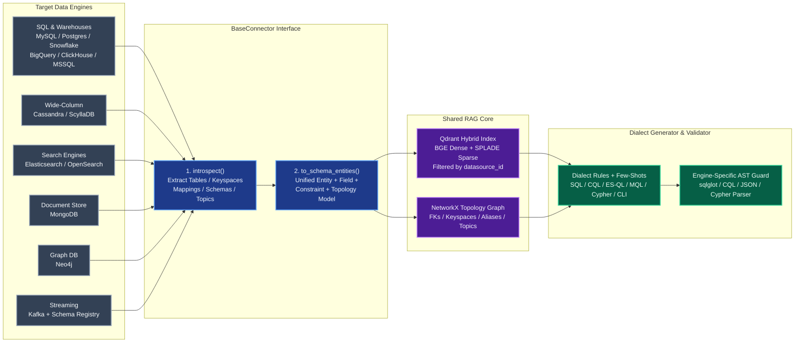

### Engine-by-Engine Technical Blueprint

#### A. Relational Databases & Cloud Data Warehouses
- **Engines**: MySQL 8+, PostgreSQL / TimescaleDB, SQL Server, Oracle, Snowflake, Google BigQuery, Amazon Redshift, Databricks SQL, ClickHouse, Trino/Presto, DuckDB.
- **Introspection**:
  - `information_schema` + engine catalogs (`pg_catalog` for Postgres materialized views & partitioned tables; `SNOWFLAKE.ACCOUNT_USAGE` / `INFORMATION_SCHEMA` for Snowflake clustering keys; BigQuery dataset/table/RECORD nested fields; ClickHouse `system.tables` / `system.columns` engine & sorting keys).
- **Prompt & Safety**:
  - Use **`sqlglot`** for dialect-aware AST parsing (replacing brittle regex keyword checks in `sql_generator.py`), detecting mutating nodes across 20+ SQL dialects accurately.
  - Inject dialect rules automatically (e.g., `DATE_TRUNC` in Postgres/Snowflake vs. `DATE_FORMAT` in MySQL; backticks vs. double quotes).

#### B. Wide-Column Stores (Cassandra / ScyllaDB)
- **Introspection**: Query `system_schema.keyspaces`, `system_schema.tables`, `system_schema.columns`, `system_schema.indexes`.
- **Crucial Indexing Fields**:
  - Explicitly tag `kind`: **`partition_key`** (`position`), **`clustering`** (`clustering_order` ASC/DESC), `regular`, `static`, plus SAI / secondary indexes.
  - Group tables by `keyspace` in the topology graph (since Cassandra models queries *per table* rather than via joins, related denormalized tables in the same keyspace/domain can be linked softly as alternative query targets).
- **Prompt & Safety**:
  - Enforce CQL rules: `WHERE` clauses must constrain the partition key (and clustering prefix in order); flag `ALLOW FILTERING` as a performance warning; allow `INSERT`/`UPDATE`/`DELETE` only as Phase-1 suggestions with TTL/upsert notes.

#### C. Search & Log Analytics (Elasticsearch / OpenSearch)
- **Introspection**: Query `/_cat/indices`, `/_alias`, `/_data_stream`, and `/<index>/_mapping` + `/_settings`.
- **Handling Huge Mappings**:
  - Production ES indices often have 200–1,000+ fields. Index each **index / data stream / alias** as a primary Qdrant point (summarizing top fields, `keyword` vs. `text` vs. `date` vs. `nested` vs. `geo_point`), and for massive mappings, index **field-group sub-chunks** linked back to the index!
  - Store index patterns (`logs-app-*`) and alias relationships in the NetworkX topology graph.
- **Target Output**:
  - Support **both** **ES|QL** (`FROM logs-app-* | WHERE status >= 500 | STATS count() BY service`) and **Query DSL JSON** (`GET /logs-app-*/_search { ... }`), configurable per workspace or user toggle.
  - Phase-1 DML suggestions: `_doc` / `_bulk` / `_update_by_query` payloads. Phase-2 MCP: strictly `_search` / `_count` / ES|QL only.

#### D. Document Databases (MongoDB)
- **Introspection**: List databases/collections + `listIndexes()`, plus **non-blocking schema sampling** (`$sample: { size: 100 }`) to infer nested document shapes, array element types, `ObjectId` references, and optional `$jsonSchema` validators.
- **Target Output**: MongoDB Query Language (`find`, `aggregate` pipelines with `$match`, `$group`, `$unwind`, `$lookup`), plus Phase-1 `insertOne` / `updateMany` / `deleteMany` suggestions.

#### E. Graph Databases (Neo4j)
- **Introspection**: `CALL db.schema.visualization()`, `SHOW CONSTRAINTS`, `SHOW INDEXES`, node labels, relationship types, and property types.
- **Topology Graph**: Maps directly 1:1 into NetworkX (`(:LabelA)-[:REL_TYPE]->(:LabelB)`), making multi-hop Cypher path retrieval extremely accurate.
- **Target Output**: Read-only `MATCH ... WHERE ... RETURN ...` Cypher, plus Phase-1 `CREATE` / `MERGE` suggestions.

#### F. Streaming & Event Platforms (Apache Kafka / Redpanda / Confluent)
Two integrated capabilities:
1. **Natural Language → Kafka Commands & Streaming SQL**:
   - **Introspection**: AdminClient (`list_topics`, `describe_topics`, `list_consumer_groups`, `describe_consumer_groups`) + **Schema Registry API** (`/subjects`, `/subjects/{s}/versions/latest` for Avro, Protobuf, JSON Schema) + optional Kafka Connect / ksqlDB REST API.
   - **Generated Outputs**:
     - Safe **Kafka CLI commands**: `kafka-topics.sh --describe`, `kafka-consumer-groups.sh --describe --group ...`, `kcat -C -t ... -c 10` (bounded consumer peek).
     - **ksqlDB / Flink SQL**: `SELECT ... FROM topic_stream WINDOW TUMBLING (SIZE 5 MINUTES) ... EMIT CHANGES;`.
     - **Phase-1 Write/Admin Suggestions**: `kcat -P` JSON/Avro payload template or `kafka-topics.sh --create` command suggestion.
2. **Kafka CDC Schema Auto-Sync (Optional Enterprise Add-On)**:
   - Subscribe to a DDL audit / Debezium schema-change topic or Schema Registry webhook so production `ALTER TABLE` / new topic registrations trigger **incremental Qdrant re-indexing** automatically within seconds.

---

## 5. Multi-Provider LLM Gateway & External Platform Interfaces

### A. Unified Provider Architecture

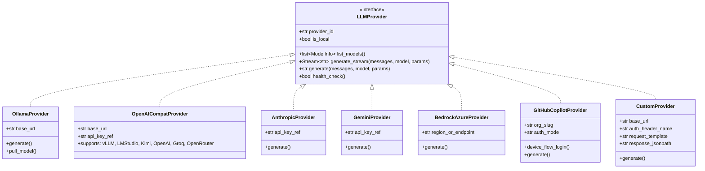

### B. Supported Model & Provider Matrix

| Category | Providers | Connection Protocol | Enterprise Policy Controls |
|---|---|---|---|
| **Local / Air-Gapped** | Ollama, vLLM, llama.cpp, LM Studio, TGI | Local HTTP / OpenAI-compatible `/v1/chat/completions` | Allowed in `STRICT_ON_PREM` & air-gapped mode; zero external egress |
| **Organization Copilot & GitHub AI** | **GitHub Copilot Enterprise / Business**, **GitHub Models** (`models.inference.ai.azure.com` / GHE) | GitHub OAuth Device Flow / Org Copilot Seat Token / GitHub App | Reuses customer's existing org-provided Copilot license—no separate OpenAI/Anthropic key needed |
| **Coding & Reasoning Cloud** | **Kimi (Moonshot AI)**, Anthropic Claude, OpenAI, Google Gemini, DeepSeek | Provider SDK / OpenAI-compatible endpoint | Encrypted API keys in Vault / K8s Secret; optional schema-name redaction |
| **Enterprise VPC Cloud** | AWS Bedrock, Azure OpenAI, Google Vertex AI | IAM / Managed Identity / PrivateLink | Keeps inference inside customer cloud perimeter |
| **Custom / Bring-Your-Own (BYO)** | Internal Corp LLM Gateways, LiteLLM Proxies, Custom Inference APIs | Custom OpenAI-compat URL, HTTP JSON Template (`request_template` + `response_jsonpath`), or `h2sql.providers` Python plugin | Supports custom auth headers (`x-corp-token`, `Bearer`), mTLS client certs, and air-gapped internal DNS |

### C. Coding-Agent & External Platform Integrations

1. **GitHub Copilot Enterprise / Business Integration (Two Ways)**:
   - **As an LLM Provider (Using Org-Provided Copilot Access)**: Developers authenticate once via `h2sql login --provider github-copilot` (GitHub OAuth Device Flow) or configure an org-approved GitHub Models endpoint; `GitHubCopilotProvider` routes query generation through the user's organization-provisioned Copilot/GitHub AI entitlement.
   - **Inside VS Code / JetBrains / GitHub.com**:
     - **Copilot Agent Mode → MCP**: Connects natively to `h2sql` per-DB MCP servers (`.vscode/mcp.json` / org MCP allowlist).
     - **GitHub Copilot Extension (`@h2sql`)**: Exposes a lightweight webhook/SSE extension endpoint (`/integrations/copilot-extension`) so developers can type `@h2sql query prod-mysql ...` directly inside GitHub Copilot Chat.
2. **Model Context Protocol (MCP) — Phase 2 (Kimi Code, Claude Code, Cursor, Antigravity, Copilot)**:
   - **Local Transport (`stdio`)**: Run `h2sql mcp` directly inside agent configs.
   - **Remote Enterprise Transport (`Streamable HTTP` + Bearer/OIDC)**: Shared team endpoints (`https://h2sql.corp.internal/mcp/<engine>`) with RBAC enforced per developer token.
   - **Exposed MCP Primitives**:
     - **Tools**: `list_datasources`, `search_schema`, `get_entity_ddl`, `generate_readonly_query`, `run_readonly_query`, `describe_kafka_topic`.
     - **Resources**: `schema://{datasource}/{entity}` returning live DDL/mappings/Avro schemas.
     - **Prompts**: Pre-tuned templates for debugging slow queries, writing migrations (suggestion-only), or inspecting event payloads.
3. **Custom Provider Plugin & HTTP Adapter (`CustomProvider`)**:
   - **No-Code UI/YAML Registration**: Customers with an internal corporate AI gateway or proprietary REST wrapper can register a custom provider by specifying `base_url`, custom auth header/mTLS certificate, optional Jinja2 `request_template`, and `response_jsonpath` (e.g., `$.data.sql`).
   - **Code-Level Plugin Hook**: Enterprises can also drop in a Python package exposing the `h2sql.providers` entry point implementing `LLMProvider` without modifying core `human_to_sql` code.
4. **OpenAI-Compatible Gateway (`/v1/chat/completions`)**:
   - Lets any platform that speaks the OpenAI protocol connect directly to your RAG pipeline as a custom model (e.g., `model: "h2sql/prod-mysql"`).
5. **REST + SSE Streaming API (`/api/v1/query/stream`)**:
   - Streams structured stages: `retrieving_schema` → `expanding_topology` → `generating_query` → `validating_safety` → `dry_run_estimate`.

---

## 6. Enterprise UI Workbench Design

Replacing [portal.html](file:///home/chinmay/git_projects/human_to_sql/portal.html) with a modular **React + TypeScript + Tailwind + Monaco Editor + React Flow** frontend:

- **Top Control Bar**:
  - **Datasource Selector**: Switch between `prod-mysql`, `analytics-snowflake`, `logs-elastic`, `events-cassandra`, `orders-kafka` (with engine badge & environment tag: `DEV` / `STAGING` / `PROD`).
  - **Model & Provider Picker**: Group models by *Local (Ollama / vLLM)* vs. *Cloud (Kimi / Claude / OpenAI / Gemini)*, showing latency, context window, and on-prem compliance badge.
  - **Mode Indicator**: `Phase 1: Read + DML Suggest` vs. `Phase 2: Read-Only Policy`.
- **Split Workbench**:
  - **Left Pane — Schema & Topology Explorer**: Searchable tree of tables/keyspaces/indices/topics + interactive **React Flow graph** showing seed matches (purple), FK/topology expansions (emerald), and join edges.
  - **Center Pane — Prompt, Monaco Editor & Output**:
    - Natural language prompt box with multi-turn follow-up (*"Now group by region and exclude test accounts"*).
    - Syntax-highlighted **Monaco Editor** (SQL, CQL, JSON/ES|QL, Cypher, Shell) with **Risk Banner** (`READ-ONLY`, `DML SUGGESTION — Review WHERE clause`, `DESTRUCTIVE — Blocked`).
    - **Dry-Run Impact Card** for DML suggestions (estimated affected rows via safe `SELECT COUNT(*)`, FK cascade warnings, transaction wrapper toggle).
    - **Read-Only Results Table + Charting** (bar/line/table auto-preview for `SELECT` queries when enabled).
  - **Right / Drawer — Provenance, History & Live Jobs**:
    - Exact RRF hybrid scores, retrieved DDLs sent to the LLM, prompt token count, and real-time **Indexing Progress Drawer** driven by CLI or UI triggers.
- **Admin Console**:
  - Manage datasources (with test-connection button), LLM provider keys, custom **Business Glossary** (e.g., mapping `"ARR"` or `"at-risk customer"` to exact SQL definitions), RBAC roles, and immutable audit logs.

---

## 7. Production Helm Charts Development Plan (In Detail)

This section specifies the production-grade Kubernetes Helm chart architecture (`helm/schema-rag/`) replacing the prototype single-pod chart, covering **Control Plane services, Per-Database MCP pods, storage persistence, NetworkPolicies, deployment profiles, and end-to-end test hardware sizing**.

### A. Kubernetes & Helm Production Topology

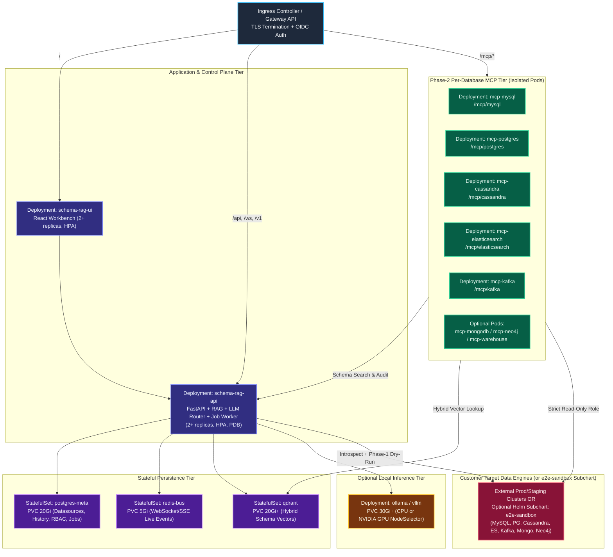

### B. Target Helm Chart Repository Structure

```text
helm/
└── schema-rag/
    ├── Chart.yaml                         # Chart v2 metadata + optional bitnami/community subcharts
    ├── values.yaml                        # Production-safe defaults (external DBs, RBAC, TLS)
    ├── values-local.yaml                  # Lightweight kind / minikube / Docker Desktop profile
    ├── values-e2e-test.yaml               # Enables e2e-sandbox DBs + seeded test jobs
    ├── values-airgap.yaml                 # Local image registry, offline model PVC, no external egress
    ├── charts/
    │   └── e2e-sandbox/                   # Optional subchart (disabled in prod) for E2E DB testing
    │       ├── Chart.yaml
    │       └── templates/
    │           ├── mysql.yaml             # Seeded MySQL 8.0
    │           ├── postgres.yaml          # Seeded PostgreSQL 16
    │           ├── cassandra.yaml         # Seeded Cassandra 4.1
    │           ├── elasticsearch.yaml     # Seeded Elasticsearch 8.x
    │           ├── redpanda-kafka.yaml    # Seeded Kafka + Schema Registry (Redpanda)
    │           ├── mongodb.yaml           # Seeded MongoDB 7
    │           └── neo4j.yaml             # Seeded Neo4j 5
    └── templates/
        ├── _helpers.tpl                   # Naming, component labels, checksum helpers
        ├── serviceaccount.yaml            # Least-privilege SA + optional IRSA/Workload Identity
        ├── configmap-core.yaml            # Non-secret app config, LLM routing, policy flags
        ├── secret-core.yaml               # DB creds, LLM API keys, OIDC client secret, JWT key
        ├── externalsecret.yaml            # Optional ExternalSecrets CRD (Vault / AWS SM / GCP SM)
        ├── deployment-ui.yaml             # React Workbench Deployment + Service
        ├── deployment-api.yaml            # Control Plane FastAPI + HPA + PodDisruptionBudget
        ├── deployment-mcp.yaml            # Range-loop generating isolated MCP Deployments & Services
        ├── statefulset-postgres.yaml      # Control Plane Metadata DB + PVC
        ├── statefulset-redis.yaml         # Pub/Sub Event Bus + PVC
        ├── statefulset-qdrant.yaml        # Hybrid Vector DB + PVC + snapshot CronJob
        ├── deployment-ollama.yaml         # Local LLM (CPU or GPU tolerations + model-puller init)
        ├── ingress.yaml                   # Path routing (UI, API/WS, /mcp/<engine>) + TLS
        ├── networkpolicy.yaml             # Zero-trust pod isolation (MCPs cannot mutate state)
        ├── job-migrate-ingest.yaml        # Post-install/upgrade DB migration + initial /ingest trigger
        └── tests/
            └── test-e2e-smoke.yaml        # `helm test` pod verifying health, ingest, query & MCP lock
```

### C. Key Helm Engineering Upgrades & Optional Self-Hosted Test DBs

1. **Eliminating `emptyDir` & `fk_graph.json` Split-Brain**:
   - All topology graphs, datasource configs, job statuses, and query histories move into **`postgres-meta` StatefulSet** (with PVC), so API replicas scale horizontally (`replicaCount >= 2`) without losing graph state.
   - `job-migrate-ingest.yaml` runs Alembic/SQL migrations first (`initContainer`), waits for `schema-rag-api` `/health`, and triggers ingestion via Control Plane API so vectors in Qdrant and topology rows in Postgres stay atomic.
2. **Optional Self-Hosted Test Databases (`e2eSandbox` Parameter)**:
   - Every supported test database we deploy ourselves is packaged in `charts/e2e-sandbox/` and controlled by **optional Helm parameters** (`false` by default in production `values.yaml`, `true` in `values-e2e-test.yaml` or via `--set`):
     ```yaml
     # values.yaml (Production Default = false; Test/Lab = true)
     e2eSandbox:
       enabled: false                  # Master switch: deploy our own test DBs + seed jobs
       mysql:        { enabled: true }
       postgres:     { enabled: true }
       cassandra:    { enabled: true }
       elasticsearch:{ enabled: true }
       kafka:        { enabled: true, mode: "redpanda" } # or "apache-kafka" (KRaft + SR + ksqlDB)
       mongodb:      { enabled: true }
       neo4j:        { enabled: true }
     ```
   - **When `e2eSandbox.enabled=true`**: Helm deploys the enabled StatefulSets/Deployments, runs deterministic seed init-jobs, **auto-generates internal Service endpoints & read-only credentials**, and automatically wires them into `schema-rag-api` and every `mcp-*` pod—so a single command spins up the entire multi-DB test lab:
     ```bash
     helm upgrade --install schema-rag ./helm/schema-rag --set e2eSandbox.enabled=true
     # Or test only specific engines (e.g., MySQL + Kafka + Cassandra):
     helm upgrade --install schema-rag ./helm/schema-rag \
       --set e2eSandbox.enabled=true \
       --set e2eSandbox.elasticsearch.enabled=false \
       --set e2eSandbox.neo4j.enabled=false
     ```
   - **When `e2eSandbox.enabled=false` (Customer Production)**: Zero test databases are deployed; customers simply pass their external DB credentials and Helm wires everything automatically.
3. **Range-Templated Per-Database MCP Pods (`deployment-mcp.yaml`)**:
   - Driven cleanly from `values.yaml` under `mcp.servers.<engine>`:
     - Each enabled engine (`mysql`, `postgres`, `cassandra`, `elasticsearch`, `mongodb`, `neo4j`, `kafka`, `warehouse`) renders its own `Deployment`, `ClusterIP Service`, `ServiceAccount`, and read-only `Secret` mount (`readonly-<engine>-credentials`).
     - Enforces `readOnlyRootFilesystem: true`, `allowPrivilegeEscalation: false`, `runAsNonRoot: true`, and `ENGINE_MODE=<engine>` + `POLICY_PROFILE=MCP_DATA_READ`.
4. **Zero-Trust Kubernetes `NetworkPolicy`**:
   - **MCP Pods**: Egress allowed **only** to `qdrant:6333`, `schema-rag-api:8000`, and the specific target database port they serve (e.g., `mcp-mysql` can only reach port `3306`, never `postgres-meta:5432` or external internet).
   - **Air-Gapped Mode (`values-airgap.yaml`)**: Blocks all public internet egress from `schema-rag-api` and `ollama`; mounts pre-seeded `ReadOnlyMany` / `ReadWriteOnce` PVC containing `bge-small-en-v1.5`, `Splade_PP_en_v1`, and GGUF weights.
5. **Helm Lifecycle & Verification Workflow**:

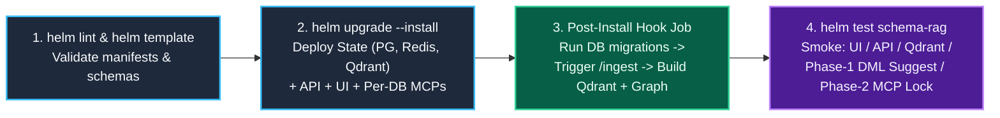

### D. Hardware Specifications for End-to-End Testing & Deployment

| Helm Values Profile | What Runs | CPU | Memory (RAM) | Storage (PVC) | GPU | Target Use Case |
|---|---|---|---|---|---|---|
| **`values-local.yaml`** | API + UI + Qdrant + Postgres + Redis + 1–2 DBs + `gemma2:2b` (or Cloud LLM) | 4–6 vCPU | 16 GB | 30 GB SSD | None | Developer laptop (`kind` / `minikube`) & fast smoke tests |
| **`values-e2e-test.yaml`** *(CPU Full Lab)* | Control Plane + UI + Qdrant + PG + Redis + **All 6 MCP pods** + **e2e-sandbox** (MySQL, PG, Cassandra, ES, Redpanda Kafka, Mongo, Neo4j) + `qwen2.5-coder:7b` / `gemma2:2b` | 8–12 vCPU | 32–64 GB | 100 GB NVMe | None (optional 16 GB VRAM) | Full end-to-end multi-engine integration & CI testing |
| **`values.yaml`** *(Production HA + Local LLM)* | 2+ API & UI replicas, HA Qdrant & PG, Per-DB MCP pods, **vLLM / Ollama (`14B–32B`)** | 16 vCPU | 64 GB | 200 GB NVMe | 1× L4 / A10G (24 GB VRAM) or A100 | Enterprise on-prem / VPC production (<2s query latency) |
| **`values.yaml`** *(Production + Cloud LLM)* | Same HA Control Plane + MCP pods; inference routed to Kimi / Claude / Bedrock / Azure | 8 vCPU | 24–32 GB | 100 GB SSD | None | Enterprise cloud deployment using external/VPC LLM APIs |

> [!NOTE]
> On 16 GB laptops, `values-e2e-test.yaml` supports **staged engine flags** (`--set e2eSandbox.profile=sql|nosql|streaming`) so Cassandra (~2.5 GB JVM) and Elasticsearch (~2.5 GB JVM) do not have to run at the exact same moment as a local 7B LLM.

### E. Production CLI & Terminal ↔ UI Synchronization (`h2sql`)

1. **CLI Packaging**: `h2sql` (`Typer` + `httpx` + `rich`) wraps `helm` and `docker` for Day-0 (`h2sql init`, `h2sql bundle --offline`, `h2sql deploy --target helm`) and communicates with the deployed Control Plane API for Day-2 operations (`h2sql login`, `h2sql source`, `h2sql ingest`, `h2sql ask`, `h2sql ui`, `h2sql mcp`).
2. **Real-Time Terminal ↔ UI Flow**: Both CLI and React UI connect to `schema-rag-api` (`POST /api/v1/ingest/jobs`, `GET /api/v1/jobs/{id}/stream` via SSE, and `WS /ws/events` backed by Redis Pub/Sub), so indexing launched from a terminal immediately updates progress bars and schema trees in open browsers, and `h2sql ask` returns a deep-link (`/workbench?q=<id>`) into the UI.

```mermaid
sequenceDiagram
    autonumber
    actor Eng as Engineer (Terminal + Browser)
    participant CLI as h2sql CLI
    participant API as Control Plane API (FastAPI)
    participant Bus as Redis Pub/Sub + Postgres
    participant Qdrant as Qdrant + Target DBs
    participant UI as Browser Web UI

    rect rgb(30, 41, 59)
        Note over Eng,UI: 1. Unified SSO Login (OAuth2 Device Flow)
        Eng->>CLI: h2sql login --server https://h2sql.corp
        CLI->>API: POST /auth/device/code
        API-->>CLI: device_code + verification_url
        CLI->>UI: Opens verification_url in browser
        Eng->>UI: Approves SSO login
        UI->>API: POST /auth/device/approve
        CLI->>API: Polls /auth/device/token -> stores JWT
    end

    rect rgb(6, 78, 59)
        Note over Eng,UI: 2. Terminal Ingestion -> Live UI Telemetry
        UI->>API: WebSocket /ws/events (subscribed)
        Eng->>CLI: h2sql ingest --source prod-cassandra --incremental
        CLI->>API: POST /api/v1/ingest/jobs
        API->>Bus: Create job_77 + stream progress
        loop Per Batch
            API->>Qdrant: Introspect + Hash Diff + Upsert Vectors & Graph
            Bus-->>CLI: Terminal progress bar
            Bus-->>UI: Live toast + progress bar + refreshed Schema Explorer
        end
    end

    rect rgb(76, 29, 149)
        Note over Eng,UI: 3. Terminal Query -> Browser Handoff
        Eng->>CLI: h2sql ask "Show failed payments or suggest backfill INSERT"
        CLI->>API: POST /api/v1/query
        API->>Bus: Save query_id=q_9481
        API-->>CLI: Query + Risk Badge + UI Deep Link
        Eng->>UI: Opens /workbench?q=q_9481
        UI->>API: GET /api/v1/queries/q_9481
    end
```

---

## 8. Per-Database MCP Development Plan (Phase 2 — In Detail)

Once Phase 1 (multi-engine connectors, provider router, DML suggestions, UI, and Helm deployment) is operational, **Phase 2** introduces **Model Context Protocol (MCP) servers for every supported database family** so coding agents (**GitHub Copilot Enterprise, Kimi Code, Claude Code, Cursor, Antigravity, VS Code**) can query live schemas and **read-only diagnostic data** safely.

### A. Credentials-Only Client Onboarding ("Zero Wiring" MCP Design)

> [!IMPORTANT]
> **Clients NEVER write MCP code, tool definitions, RAG pipelines, or prompt rules.**
> A client **only provides database credentials** (via Helm `values` / `Secret` / `ExternalSecret`, `h2sql source add`, or the Admin UI). Everything else—schema indexing, topology graph building, tool registration, AST read-only guardrails, PII redaction, NetworkPolicies, and ready-to-paste IDE/agent JSON—is **already built and auto-wired**.

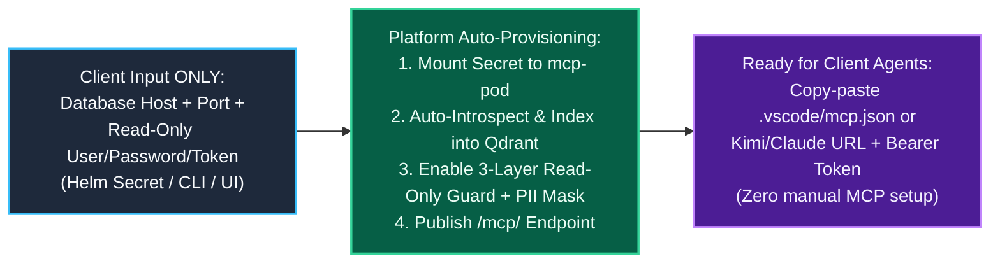

### B. Modular MCP Architecture (Shared Core + Dedicated Per-Engine Servers)

Instead of writing 8 unrelated servers or exposing 1 giant unsafe server with all credentials combined, we build one reusable **`mcp_core` framework** instantiated as **per-database MCP servers/endpoints**:

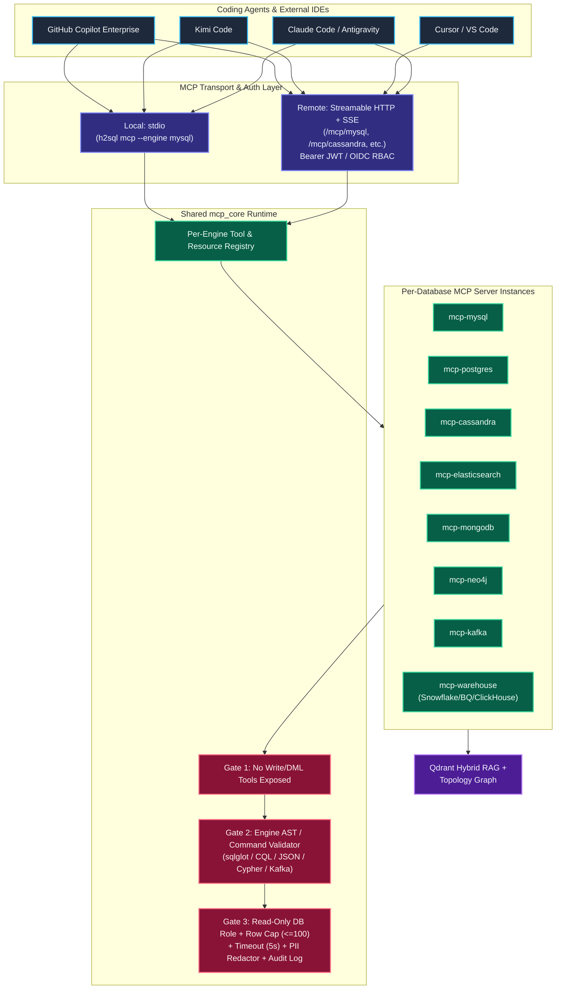

### C. Per-Database MCP Package Layout

```text
schema_rag/
└── mcp_servers/
    ├── core/
    │   ├── base_server.py       # FastMCP / official Python MCP SDK wrapper (stdio + Streamable HTTP)
    │   ├── auth.py              # OIDC/JWT validation, datasource-level RBAC scope checks
    │   ├── policy.py            # Strict MCP_DATA_READ enforcer (blocks all INSERT/UPDATE/DELETE/DDL)
    │   ├── pii_redactor.py      # Column/regex masking (email, phone, ssn, token, card_*)
    │   └── audit.py             # Structured immutable audit logging to Postgres Control Plane
    ├── engines/
    │   ├── mysql_mcp.py         # Tools & AST guard for MySQL / MariaDB
    │   ├── postgres_mcp.py      # Tools & AST guard for PostgreSQL / TimescaleDB
    │   ├── warehouse_mcp.py     # Tools & cost/bytes-scanned guard for Snowflake / BigQuery / ClickHouse
    │   ├── cassandra_mcp.py     # Tools & partition-key guard for Cassandra / ScyllaDB
    │   ├── elasticsearch_mcp.py # Tools & DSL/ES|QL read-only guard for Elasticsearch / OpenSearch
    │   ├── mongodb_mcp.py       # Tools & pipeline stage allowlist for MongoDB
    │   ├── neo4j_mcp.py         # Tools & Cypher clause guard for Neo4j
    │   └── kafka_mcp.py         # Tools & bounded topic-peek / Schema Registry guard for Kafka
    └── entrypoint.py            # CLI/Docker launcher: `python -m schema_rag.mcp_servers.entrypoint --engine mysql`
```

### D. Per-Database MCP Tools, Resources & Guardrails Specification

Every MCP server exposes a **standardized base surface** plus **engine-specific read-only tools**:

- **Standard Resources (on every MCP server)**:
  - `schema://{datasource}/summary` — List of entities, descriptions, and topology overview.
  - `schema://{datasource}/{entity}` — Full DDL / mapping / Avro schema / CQL definition.
- **Standard Tools (on every MCP server)**:
  - `search_schema(question, top_k=5)` → Hybrid Qdrant search + topology expansion returning minimal relevant DDLs.
  - `explain_query(query)` → Runs `EXPLAIN` / dry-run cost check without scanning full tables.

| MCP Server | Dedicated Read-Only Tools | Strict Engine-Level Guardrails (Phase-2 Locks) |
|---|---|---|
| **`mcp-mysql`** | `run_mysql_query(sql, limit=100)`<br>`list_mysql_views()` | `sqlglot(dialect="mysql")` AST allowlist: `SELECT`, `WITH`, `SHOW`, `EXPLAIN` only. `SET SESSION MAX_EXECUTION_TIME=5000`, `SET SESSION TRANSACTION READ ONLY`, DB user has `SELECT` privilege only. Rejects `INSERT`, `UPDATE`, `DELETE`, `INTO OUTFILE`, `SLEEP`, multi-statements. |
| **`mcp-postgres`** | `run_postgres_query(sql, limit=100)`<br>`list_schemas_and_views()` | `sqlglot(dialect="postgres")` AST allowlist. Enforces `SET default_transaction_read_only = on`, `SET statement_timeout = '5000ms'`, `LIMIT` injection if missing. |
| **`mcp-warehouse`** | `run_warehouse_query(sql, max_bytes_gb=1, limit=100)`<br>`estimate_query_cost(sql)` | Pre-flight dry-run (`BigQuery dry_run`, `Snowflake EXPLAIN`) rejects scans exceeding `max_bytes_gb` before executing; strictly `SELECT`/`WITH`. |
| **`mcp-cassandra`** | `run_cql_query(cql, limit=100)`<br>`describe_keyspace(keyspace)` | CQL parser blocks `INSERT`, `UPDATE`, `DELETE`, `BATCH`, `TRUNCATE`, `DROP`, `ALTER`. **Rejects `ALLOW FILTERING`** by default and verifies `WHERE` includes the table's partition key. |
| **`mcp-elasticsearch`** | `search_es_dsl(index, body_json, size=50)`<br>`run_esql(query)`<br>`get_index_mapping(index)` | Only hits `/_search`, `/_count`, `/_esql`, `/_mapping`. Rejects `_delete_by_query`, `_update_by_query`, `_reindex`, scripts (`ctx._source`), and enforces `size <= 100` + `timeout: "5s"`. |
| **`mcp-mongodb`** | `find_documents(collection, filter_json, projection_json, limit=50)`<br>`aggregate_readonly(collection, pipeline_json)` | Pipeline stage allowlist (`$match`, `$project`, `$group`, `$sort`, `$limit`, `$unwind`, `$count`, `$lookup` only). **Blocks `$out`, `$merge`, `$where`, `$function`**. Uses read-only secondary preferred role. |
| **`mcp-neo4j`** | `run_cypher_readonly(cypher, limit=100)`<br>`get_graph_schema()` | Cypher parser + Neo4j driver `ACCESS_MODE_READ` (`session(default_access_mode=READ)`). Blocks `CREATE`, `MERGE`, `DELETE`, `DETACH`, `SET`, `REMOVE`, `CALL dbms.*` writes. |
| **`mcp-kafka`** | `list_topics(pattern)`<br>`describe_topic(topic)`<br>`get_schema_registry_subject(subject)`<br>`get_consumer_lag(group_id)`<br>`peek_topic_messages(topic, max_messages=10)`<br>`run_ksqldb_pull_query(sql)` | **Zero produce / admin-mutate tools**. `peek_topic_messages` hard-capped at `<= 20` messages with `3s` poll timeout and PII field redaction on Avro/JSON payloads. `ksqlDB` allows pull `SELECT` only (blocks `CREATE STREAM`, `INSERT INTO`, `DROP`). |

### E. Phase-2 MCP End-to-End Request & 3-Layer Security Sequence

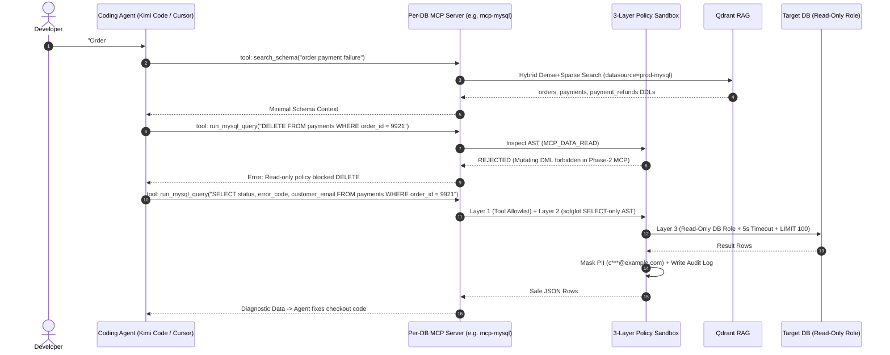

### F. Coding Agent Configuration Examples (GitHub Copilot, Kimi Code, Cursor, Antigravity)

The Control Plane UI & CLI (`h2sql mcp config`) automatically generate these ready-to-use files once credentials are saved:

**1. Remote Enterprise MCP (Kubernetes Helm Deployment via Streamable HTTP / `.vscode/mcp.json` for GitHub Copilot & Cursor):**
```json
{
  "mcpServers": {
    "prod-mysql": {
      "url": "https://h2sql.corp.internal/mcp/mysql",
      "headers": { "Authorization": "Bearer ${H2SQL_MCP_TOKEN}" }
    },
    "prod-cassandra": {
      "url": "https://h2sql.corp.internal/mcp/cassandra",
      "headers": { "Authorization": "Bearer ${H2SQL_MCP_TOKEN}" }
    },
    "prod-kafka": {
      "url": "https://h2sql.corp.internal/mcp/kafka",
      "headers": { "Authorization": "Bearer ${H2SQL_MCP_TOKEN}" }
    }
  }
}
```

**2. Local Developer CLI Mode (`stdio`):**
```json
{
  "mcpServers": {
    "local-elasticsearch": {
      "command": "h2sql",
      "args": ["mcp", "--engine", "elasticsearch", "--source", "dev-logs"]
    }
  }
}
```

---

## 9. Securing Customer-Provided Credentials (Zero-Trust Secrets Architecture)

Because customers provide sensitive database passwords, Kafka SASL/SSL keys, and LLM API tokens via Helm, CLI, or UI, credentials are protected across **storage, transit, pod isolation, and zero-leakage boundaries**.

### A. End-to-End Credential Flow & Isolation Diagram

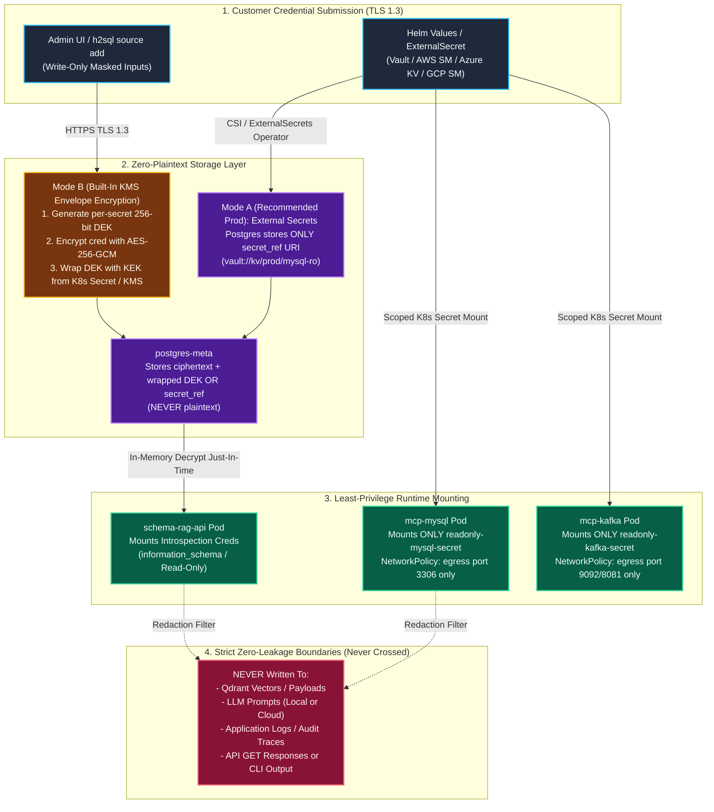

### B. Five-Layer Credential Security Controls

| Security Layer | Mechanism | What It Prevents |
|---|---|---|
| **1. Storage (Zero Plaintext)** | **Mode A**: Reference external secret managers (HashiCorp Vault, AWS Secrets Manager, Azure Key Vault, GCP Secret Manager) via Kubernetes `ExternalSecret`—`postgres-meta` stores only `secret_ref`.<br>**Mode B**: When no external vault exists, encrypt every credential with **AES-256-GCM envelope encryption** (unique per-credential DEK wrapped by a master KEK mounted from K8s Secret / KMS). | Database dumps, backups, or DB admins reading raw passwords or API keys. |
| **2. Role Separation (Least Privilege)** | **Phase-1 Introspection Creds**: Scoped to metadata views (`information_schema`, `system_schema`, `/_mapping`, Kafka `Describe`) + optional dry-run `SELECT COUNT(*)`.<br>**Phase-2 MCP Creds**: Dedicated database-enforced **read-only user** (`SELECT` only, `READ` access mode) that **cannot** run `INSERT`/`UPDATE`/`DELETE` even if application code were compromised. | Blast radius if a credential or pod is misused. |
| **3. Per-Pod Isolation (`NetworkPolicy`)** | Each `mcp-<engine>` Kubernetes pod uses a dedicated `ServiceAccount` and mounts **only its own engine's read-only `Secret`**. `NetworkPolicy` blocks `mcp-mysql` from reaching `postgres-meta`, other MCP pods, or unrelated DB ports. | Lateral movement across databases from a single compromised MCP container. |
| **4. Transit & Auth Hardening** | Mandatory TLS 1.3 for CLI/UI/MCP traffic; DB connections enforce TLS/mTLS (`sslmode=verify-full`, SASL_SSL for Kafka, client certs for Cassandra/ES); short-lived JWTs/OIDC tokens for MCP & CLI (`h2sql login`). | Credential sniffing on internal VPC or cluster networks. |
| **5. Zero-Leakage & Rotation** | Secrets are write-only in UI/API (always masked `********` on `GET`), scrubbed by a log-redaction filter, **never** stored in Qdrant payloads or sent inside LLM prompts, and support zero-downtime key rotation (`h2sql secret rotate` / ExternalSecret refresh). | Accidental exposure of secrets in logs, audit exports, vector indices, or Cloud LLM calls. |

---

## 10. Phased Implementation Roadmap & Concrete Deliverables

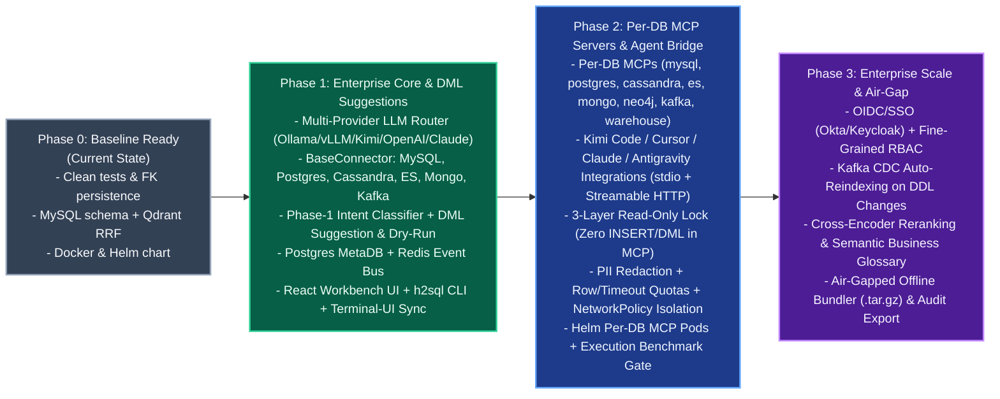

### Detailed Module Mapping (From Current Repo → Target Structure)

| Current File | Enterprise Evolution |
|---|---|
| [schema_rag/config.py](file:///home/chinmay/git_projects/human_to_sql/schema_rag/config.py) | Dynamic workspace/control-plane settings backed by Postgres + Vault/K8s Secrets + `h2sql.yaml` |
| [schema_rag/db/mysql_client.py](file:///home/chinmay/git_projects/human_to_sql/schema_rag/db/mysql_client.py) | `connectors/` package (`BaseConnector` + `mysql`, `postgres`, `snowflake`, `cassandra`, `elasticsearch`, `mongodb`, `neo4j`, `kafka`) |
| [schema_rag/db/fk_graph.py](file:///home/chinmay/git_projects/human_to_sql/schema_rag/db/fk_graph.py) | `topology/graph_engine.py` persisted in Postgres/object store per `datasource_id` (FKs, keyspace relations, ES aliases, Kafka topic-schema links) |
| [schema_rag/qdrant_store/upsert.py](file:///home/chinmay/git_projects/human_to_sql/schema_rag/qdrant_store/upsert.py) | Incremental hash-diff indexer with `datasource_id` payload filtering & large-mapping chunking (for Elasticsearch/Warehouses) |
| [schema_rag/llm/sql_generator.py](file:///home/chinmay/git_projects/human_to_sql/schema_rag/llm/sql_generator.py) | `llm/gateway.py` (Ollama, vLLM, Kimi, OpenAI, Anthropic, Gemini, Bedrock) + `policy/guardrails.py` (`WORKBENCH_SUGGEST` vs. `MCP_DATA_READ`) |
| [schema_rag/api/app.py](file:///home/chinmay/git_projects/human_to_sql/schema_rag/api/app.py) | Control Plane API (`REST` + `SSE/WebSocket` job/query streams + `OpenAI-compat` + `OAuth Device Flow`) + `schema_rag/mcp_servers/` (`core/` + per-DB MCP servers) |
| [portal.py](file:///home/chinmay/git_projects/human_to_sql/portal.py) / [portal.html](file:///home/chinmay/git_projects/human_to_sql/portal.html) | `web/` React + TypeScript + Monaco + React Flow Enterprise Workbench |
| [helm/schema-rag/](file:///home/chinmay/git_projects/human_to_sql/helm/schema-rag/values.yaml) | Multi-tier Helm chart (`deployment-ui`, `deployment-api`, `deployment-mcp` range pods, `postgres-meta`, `redis-bus`, `qdrant`, `networkpolicy`, `e2e-sandbox` subchart, `values-e2e-test`, `values-airgap`) |
| [schema_rag/scripts/](file:///home/chinmay/git_projects/human_to_sql/schema_rag/scripts/ingest.py) | `cli/` (`h2sql` Typer CLI: `init`, `bundle`, `deploy`, `login`, `source`, `ingest`, `ask`, `ui`, `mcp`) |

---

## 11. Key Decisions Needed Before Implementation

> [!TIP]
> Confirming these four choices will lock in the exact build order for Phase 1:

1. **First Connector Batch**: After MySQL, should Phase 1 prioritize **PostgreSQL + Elasticsearch + Cassandra + Kafka** first, and add Snowflake/BigQuery/MongoDB/Neo4j next?
2. **Metadata Store & Event Bus**: Are **PostgreSQL + Redis** acceptable as standard Control Plane dependencies in Docker Compose and Helm (with SQLite + in-memory fallback for single-user local CLI mode)?
3. **Phase-1 DML Behavior**: Should DML (`INSERT` / `UPDATE` / `DELETE`) always be **suggestion + dry-run count preview + copy/export only**, or should there also be an explicit `"Execute in Sandbox/Dev"` button gated behind user confirmation + non-prod environment tags?
4. **LLM Gateway Strategy**: Do you prefer implementing lightweight native adapters (`httpx` for Ollama, OpenAI-compatible/Kimi, Anthropic, Gemini) to keep dependencies minimal, or adopting `litellm`?
