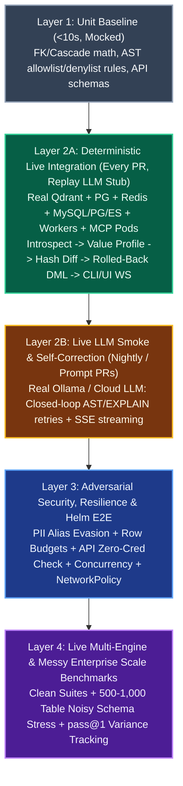
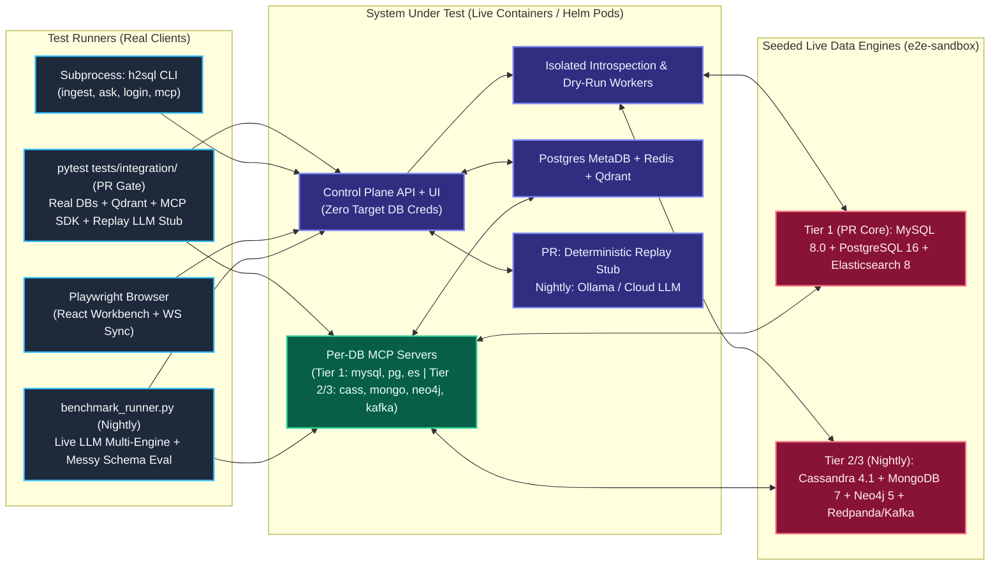
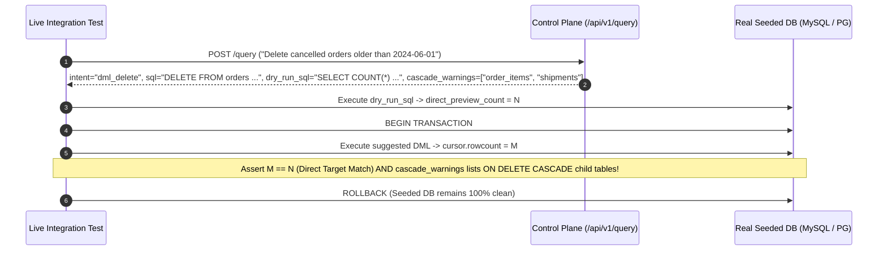

# Live Integration & Multi-Engine Benchmark Test Plan (v2 — Deterministic CI & Enterprise Stress Suite)

> [!NOTE]
> Fast mocked unit tests (`tests/unit/`) validate local pure logic in under 10 seconds. This revised test plan separates **deterministic live integration tests** (fast, 0% LLM flakiness on every PR against real containers) from **nightly live-LLM accuracy and messy-schema scale benchmarks**, and expands security verification to cover **PII alias evasion, exfiltration row budgets, credential blast-radius isolation, and service resilience**.

---

## 1. Decoupled Live-First Testing Pyramid

Running live CPU LLM inference inside every PR gate creates slow, flaky builds due to model variance. v2 splits Layer 2 into **2A (Deterministic Live Integration — Every PR)** and **2B (Live LLM Smoke & Self-Correction — Nightly / Model PRs)** so real infrastructure boundaries are tested on every commit with zero nondeterministic failures.



---

## 2. Live Integration Test Harness & Staged Profiles

All integration tests run against **real containerized services** via `docker-compose.e2e.yml` / `Testcontainers` (CI) or `helm install -f values-e2e-test.yaml` (Kubernetes).

### A. Live Test Environment Topology



### B. Staged Execution Profiles

| Profile Flag | Containers Started | Host Spec Needed | CI Cadence |
|---|---|---|---|
| `profile=pr-core` *(Tier-1 Deterministic)* | API + UI + Workers + PG Meta + Redis + Qdrant + MySQL 8 + PG 16 + ES 8 + 3 MCP pods + **Replay LLM Stub** | **6 vCPU, 16 GB RAM, 40 GB SSD** | **Every PR (~2–4 min, 0% flake)** |
| `profile=tier1-live-llm` | Same as `pr-core` + real Ollama (`gemma2:2b` / `qwen2.5-coder:7b`) or Cloud LLM | **8 vCPU, 20–24 GB RAM, 60 GB SSD** | **Nightly & Prompt/Model PRs** |
| `profile=tier2-nosql` | Core + Cassandra 4.1 + MongoDB 7 + `mcp-cassandra` + `mcp-mongodb` | **8 vCPU, 24 GB RAM, 60 GB SSD** | **Phase-2 Nightly CI** |
| `profile=full` *(Redpanda Kafka)* | All 7 target engines + 7 MCP pods + Control Plane + Workers + Ollama / Cloud LLM | **10–12 vCPU, 32 GB RAM, 100 GB NVMe** | **Pre-Release Full Lab** |
| `profile=full-jvm` *(Apache Kafka + ksqlDB)* | Full Apache Kafka (KRaft) + Schema Registry + ksqlDB + all DBs + `7B` Q4 LLM | **16 vCPU, 48–64 GB RAM, 120 GB NVMe** | **Phase-3 Streaming Release Gate** |

### C. Key Memory & Resource Engineering Rules

- **Centralized Embeddings**: `bge-small-en-v1.5` (~130 MB) + `Splade_PP_en_v1` (~450 MB) live only in `schema-rag-api` (`2–4 Gi` RAM). All per-DB MCP pods stay under `192–384 Mi` RAM.
- **Deterministic Stub Saves 4–8 GB in PR CI**: Using a replay LLM stub for `profile=pr-core` eliminates local LLM RAM and CPU inference latency during infrastructure/security PR checks.

---

## 3. Live Integration Test Matrix (Subsystem by Subsystem)

### A. Control Plane, Semantic Layer & Topology Persistence (`test_control_plane_live.py`)

1. **Incremental Hash-Diff Ingestion & Value Profiling**:
   - Ingest live MySQL/Postgres schemas via isolated workers into Qdrant.
   - Verify low-cardinality non-PII `VARCHAR` columns (`customer_segments.name`) are profiled while PII-tagged columns (`customers.email`) are excluded from value sampling.
   - Alter 1 column (`ALTER TABLE orders ADD COLUMN priority VARCHAR(20)`), run `h2sql ingest --incremental`, and assert **only 1 point** is re-embedded while unchanged tables are skipped.
2. **Semantic Layer Retrieval & Mandatory Predicate Injection**:
   - Seed a Golden Query and a mandatory predicate (`orders.deleted_at IS NULL`) in `postgres-meta`.
   - Assert retrieval returns the Golden Query in context and the AST policy validator rejects any generated query on `orders` missing `deleted_at IS NULL`.
3. **Topology Persistence Across Pod Restarts**:
   - Restart `schema-rag-api` after `/ingest` and assert multi-hop FK/cascade queries succeed immediately from `postgres-meta` without re-ingesting.
4. **Closed-Loop Self-Correction (`profile=tier1-live-llm`)**:
   - Inject a deliberate first-turn column typo in a test prompt/stub, verify the worker catches the real MySQL/PG `EXPLAIN` error, feeds it back, and returns a valid corrected query within `<= 2` retries.

### B. Cascade-Aware Phase-1 DML Rollback Verification (`test_dml_rollback_live.py`)

Each DML test runs against a **real seeded database** inside an explicit rolled-back transaction:



- **Cascade Safety Assertion**: Explicitly test deleting a parent `orders` row that has `ON DELETE CASCADE` children in `order_items`. Assert that (a) `dry_run_preview_sql` matches direct parent `rowcount`, (b) `cascade_warnings` explicitly names `order_items`, and (c) the response label states *"Direct target rows (excludes cascades/triggers)"*.
- **Tier-1 Engine Coverage**:
  - **MySQL 8.0**: `ENUM`, `DECIMAL`, `AUTO_INCREMENT`, `JSON`, `VIEW`, `INSERT`/`UPDATE`/`DELETE` rollback checks.
  - **PostgreSQL 16**: Multi-schema, `JSONB`, materialized views, `INSERT ... ON CONFLICT DO UPDATE` rollback checks.
  - **Elasticsearch 8.x**: `/_mapping` sub-chunking, `ES|QL` + Query DSL reads, `_update_by_query` dry-run via `_count`.
  - *(Tier-2/3 suites for Cassandra, MongoDB, Neo4j, Kafka activate in Phase 2/3 profiles.)*

### C. Expanded Phase-2 MCP Adversarial Security Suite (`test_mcp_security_live.py`)

Using the **official Python MCP Client SDK** over `stdio` and `Streamable HTTP`:

1. **DML & Injection Bypass Matrix (Must Reject 100.0%)**:
   - Standard `INSERT`, `UPDATE`, `DELETE`, `DROP`, `TRUNCATE`, `ALTER`.
   - Comment & multi-statement bypasses: `/* select */ DELETE FROM orders;`, `SELECT 1; DROP TABLE customers;`.
   - Engine-specific escapes: MySQL `INTO OUTFILE` / `SLEEP(10)`, Postgres `COPY ... TO PROGRAM`, ES `_delete_by_query` / `_reindex` / Painless write scripts, Cassandra `ALLOW FILTERING` / `BATCH`, MongoDB `$out` / `$merge` / `$where`, Neo4j `CREATE` / `MERGE` / `DETACH DELETE`, Kafka produce / `--reset-offsets`.
   - Verify Layer-3 DB-level enforcement by testing a direct write attempt with the mounted MCP DB credentials—must fail at the database engine with permission denied.
2. **PII Evasion & `SELECT *` Rejection Matrix (New in v2)**:
   - Submit `SELECT * FROM customers LIMIT 5` -> **must reject** (`SELECT *` disallowed in MCP).
   - Submit `SELECT email AS x FROM customers LIMIT 5` -> **must reject** at AST column denylist (catches alias evasion).
   - Submit `SELECT CONCAT(first_name, ':', phone) AS info FROM customers LIMIT 5` -> **must reject** at AST column denylist (catches expression wrapping).
   - Seed a free-text `support_tickets.notes` cell containing `"Call me at 555-019-2834 or test@corp.com"` -> query `SELECT notes FROM support_tickets LIMIT 1` -> assert **Layer-4 value-based PII scanner** redacts both phone and email in the returned JSON.
3. **Fine-Grained Table/Column RBAC & Zero Schema Leakage (New in v2)**:
   - Authenticate as a developer role restricted from `payroll_salaries`.
   - Call `search_schema("employee salary compensation")` -> assert `payroll_salaries` DDL is **absent** from retrieved schema context.
   - Call `run_postgres_query("SELECT base_pay FROM payroll_salaries LIMIT 5")` -> assert **hard reject** + security audit record.
4. **Anti-Exfiltration Session Row Budgets & Rate Limits (New in v2)**:
   - Run rapid paginated queries (`LIMIT 100 OFFSET 0, 100, 200, ...`) until exceeding the configured per-session row budget (e.g., 500 rows in test config).
   - Assert the MCP server blocks subsequent queries with a rate/budget error and emits an anomaly audit event.

### D. Resilience, Concurrency & Failure-Mode Suite (`test_resilience_live.py` — New in v2)

- **Concurrent MCP Burst**: Spawn 20 concurrent MCP client requests against `mcp-postgres` and `mcp-mysql` -> assert bounded connection pool behavior, zero deadlocks, and accurate per-user audit attribution.
- **Hung Database Circuit Breaker**: Inject a slow query (`SELECT pg_sleep(10)`) -> assert `statement_timeout` aborts cleanly within `<= 5.5s` and releases the DB connection back to the pool.
- **Dependency Degradation**: Temporarily pause Redis -> assert `/api/v1/query` still succeeds synchronously without crashing (degrading only live WebSocket broadcasts) and auto-reconnects when Redis recovers.

### E. Live Terminal (`h2sql`) <-> Backend <-> Playwright UI Sync (`test_cli_ui_sync_live.py`)

- CLI-triggered `h2sql ingest --source test-mysql` updates an open Playwright Workbench UI in real time over `WS /ws/events` without manual refresh.
- `h2sql ask` returns a `query_id` deep-link that renders matching SQL, Risk Banner, and React Flow topology graph in Playwright.
- `h2sql login` completes OAuth2 Device Flow approval in Playwright and stores a scoped JWT.

### F. Live Helm & Zero-Trust NetworkPolicy Verification (`tests/e2e_helm/test_helm_cluster.py`)

- `helm lint` + `helm template` across all 4 profiles (`values.yaml`, `values-local.yaml`, `values-e2e-test.yaml`, `values-airgap.yaml`).
- Deploy `values-e2e-test.yaml` on `kind`/`k3s` and run `helm test schema-rag`.
- **Zero-Trust Blast-Radius Probes**:
  1. From **`schema-rag-api` pod**: attempt TCP connect to `e2e-mysql:3306` and `e2e-postgres:5432` -> **must be blocked by `NetworkPolicy`** (proving API has no direct DB path or credentials).
  2. From **`mcp-mysql` pod**: attempt TCP connect to `postgres-meta:5432` and `e2e-elasticsearch:9200` -> **must be blocked by `NetworkPolicy`**.

---

## 4. Audit & Overhaul Plan for Existing `@benchmark` Suite

Before scaling to multiple engines, fix the data and evaluation bugs in benchmark/:

### A. Fixes to `generate_suite.py` & `seed_data.sql`

| Bug Found | Impact | Exact Fix |
|---|---|---|
| `categories.parent_id` & `employees.manager_id` self-reference (`2 -> 2`, `3 -> 3`) | Recursive CTEs (`TC029`, `TC127`) return 1 row; self-joins (`TC009`) are invalid | Seed real 3-level trees (`1 <- 2 <- 3`, plus 4–6 children) so recursive CTEs traverse depths `0, 1, 2`. |
| `customers.segment_id`, `birth_date`, `last_name`, `addresses.line2` never `NULL` | `TC024`–`TC026`, `TC110`, `TC122`, `TC143` never test `NULL` branches | Seed intentional `NULL` rows across all nullable filter columns. |
| `TC015` / `TC139` ask for `"VIP segment"` while DB has `'Customer Segments 1'` | Forces impossible hallucination | Seed realistic values (`'VIP'`, `'Standard'`, `'Enterprise'`) and enable low-cardinality value profiling. |
| `TC032`, `TC129`, `TC139` hardcode `'2026-07-24'` | Valid `CURDATE()`/`NOW()` queries fail row match | Seed relative dates at container startup or pass a fixed `--reference-date` in benchmark context. |
| `TC137` (`REGEXP '[0-9]'`) matches 100% of seeded products | Cannot distinguish `REGEXP` filter from no filter | Mix alphabetic-only (`'Classic Leather Tote'`) and alphanumeric (`'Studio Monitor 27'`) product names. |
| `TC036`–`TC108` repeat 3 trivial templates 73 times | Artificially inflates pass rate | Replace redundant loops with diverse multi-table business queries, **Phase-1 DML + Cascade cases**, and **Phase-2 MCP refusal cases**. |

### B. Fixes to `benchmark_runner.py`

1. **Replace broken `wrong_tables()`**: Compute **Table Recall@K** (`|expected ∩ retrieved| / |expected|`) and **Table Precision@K** (`|expected ∩ retrieved| / |retrieved|`) across both base tables and `v_*` views, reporting retrieval accuracy independently from LLM SQL accuracy.
2. **Fix `compare_rows()` projection fragility**: Support `strict`, `column_bag` (order-independent columns), and `entity_relaxed` (key/value multiset containment for open-ended questions).
3. **Comment-safe AST validation**: Replace naive `READ_ONLY_PREFIXES` string checks with `sqlglot` AST parsing so leading `--` / `/* ... */` comments are handled safely while multi-statements remain blocked.
4. **Variance Tracking**: Run nightly live-LLM benchmarks with `pass@1` and `pass@3` reporting plus latency percentiles (`p50`, `p95`) so regressions are statistically distinguishable from model noise.

---

## 5. Multi-Engine & "Messy Enterprise Schema" Benchmark Suites

### Phased Benchmark Rollout

| Benchmark Suite | Phase | Case Count | Key Concepts & Stress Tests | Evaluation Oracle |
|---|---|---|---|---|
| **MySQL 8.0 (Upgraded)** | Phase 1 | 150 | Joins, Recursive CTEs, Window Functions, `FULLTEXT`, `JSON`, Views + 15 DML/Cascade + 15 MCP/PII Refusals | Live MySQL execution + rolled-back DML |
| **PostgreSQL 16** | Phase 1 | 60 | Multi-schema, `JSONB` (`@>`), `DATE_TRUNC`, Materialized Views, `ON CONFLICT` DML, `SET ROLE` RBAC | Live Postgres execution + rolled-back DML |
| **Elasticsearch 8.x** | Phase 1 | 40 | `ES|QL` aggregations, nested objects, date histograms, alias resolution, `_update_by_query` dry-run | Live ES `/_search` & `/_esql` execution |
| **Messy Enterprise Stress Suite (New)** | Phase 1 | 50 | **500–1,000 tables** in Postgres/MySQL with noise (`orders_bak_2024`, `tmp_export_1`), duplicate table names across schemas, cryptic columns (`tbl_ord_hdr`, `flg_actv`), and mandatory soft-delete predicates | Tests Table Allowlists, Golden Queries, Glossary, & RRF Retrieval Recall@K under enterprise noise |
| **Tier-2 Suites (Snowflake/BQ, Cassandra, MongoDB)** | Phase 2 | 100+ | Cost dry-runs, partition-key CQL, `$unwind`/`$lookup` pipelines, `$out`/`ALLOW FILTERING` blocks | Live container / sandbox execution + AST equivalence |
| **Tier-3 Suites (Neo4j, Kafka/ksqlDB)** | Phase 3 | 55+ | Multi-hop Cypher, Avro Schema Registry, bounded topic peek, `ksqlDB` pull queries | Live execution + semantic/AST CLI oracle |

### Release Gate Scorecard

| Metric | Phase-1 Local (`7B`) | Enterprise Target (`14B+` / Cloud) | Gate Type |
|---|---|---|---|
| **Retrieval Table Recall@K (Clean / Messy 500+ Tables)** | >= 92% / >= 85% | >= 96% / >= 92% | Hard Gate |
| **Read Query Execution Accuracy (with 1-2 Turn Self-Correction)** | >= 78% | >= 90% | Hard Gate |
| **Phase-1 DML Validity + Direct-Row Dry-Run + Cascade Warning** | >= 82% | >= 92% | Hard Gate |
| **Phase-2 MCP Mutating / PII-Evasion / RBAC-Leak Rejection** | **100.0%** | **100.0%** | **Strict Blocker** |
| **PR Deterministic Integration Suite Flake Rate** | **0.0%** | **0.0%** | **Strict Blocker** |
| **End-to-End Query Latency (p95)** | <= 15s (CPU) / <= 2.5s (GPU) | <= 4s | Advisory / SLA |

---

## 6. Test Directory Layout & CI Cadence

```text
tests/
├── unit/                          # <10s mocked pure logic (every commit)
│   ├── test_fk_and_cascade.py
│   ├── test_ast_policy_and_pii.py
│   └── test_retriever.py
├── integration/                   # LIVE containerized tests (Replay LLM Stub on PRs)
│   ├── conftest.py                # Docker Compose / Testcontainers + staged profiles
│   ├── test_control_plane_live.py # PG MetaDB, Semantic Layer, Value Profiling, Hash Diff
│   ├── test_connectors_live.py    # Tier-1 (MySQL, PG, ES) + Tier-2/3 real introspection
│   ├── test_dml_rollback_live.py  # DML dry-run == rolled-back rowcount + cascade warnings
│   ├── test_mcp_security_live.py  # 100% DML block, PII alias evasion, RBAC leak, row budgets
│   ├── test_resilience_live.py    # Concurrency bursts, timeouts, Redis/Qdrant recovery
│   └── test_cli_ui_sync_live.py   # Subprocess h2sql CLI + Playwright live WS assertions
└── e2e_helm/
    └── test_helm_cluster.py       # kind/k3s install, API zero-cred NetworkPolicy, helm test
```

**CI Execution Cadence:**
1. **Every PR (2–4 min, 0% flake)**: `tests/unit/` + `tests/integration/ -m pr_core` (real DBs/Qdrant/Redis/MCPs with deterministic Replay LLM Stub).
2. **Nightly / Prompt & Model PRs**: `profile=tier1-live-llm` self-correction smoke + full Tier-1 & Messy Enterprise 500+ Table live benchmarks (`pass@1` tracking).
3. **Pre-Release Gate**: `helm lint` -> `kind` `values-e2e-test.yaml` -> `NetworkPolicy` zero-trust blast-radius probes -> `helm test` -> 100.0% MCP security & benchmark release gates.
