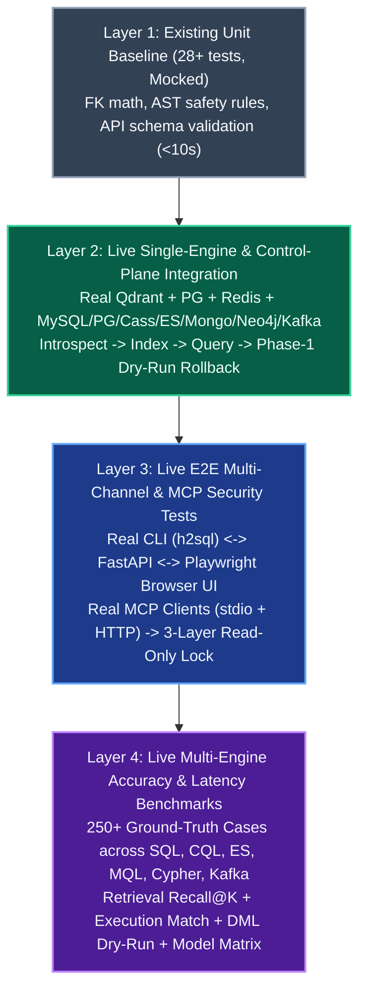
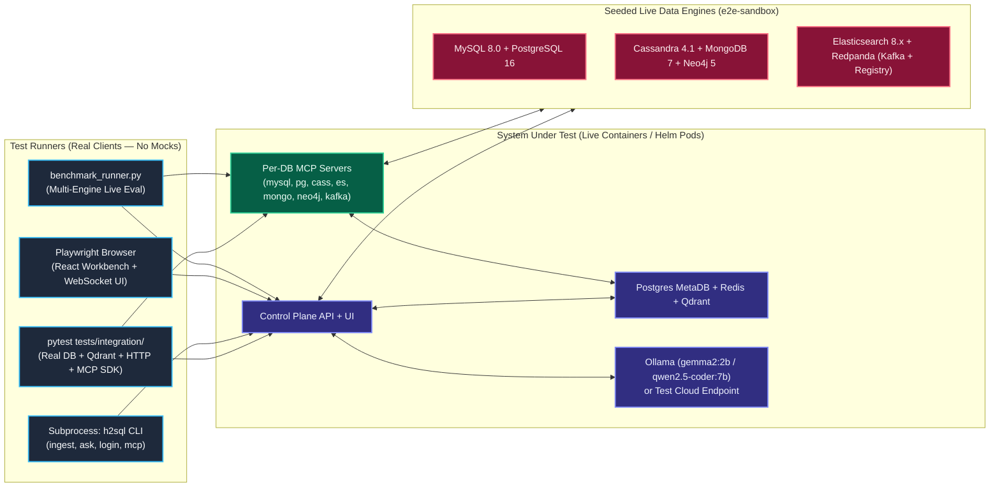
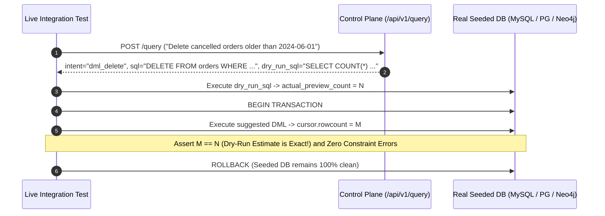
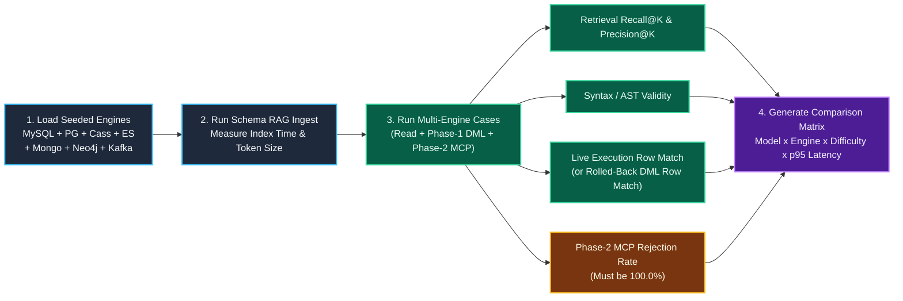

# Live Integration & Multi-Engine Benchmark Test Plan

> [!NOTE]
> Fast mocked unit tests (`tests/test_fk_graph.py`, `tests/test_retriever.py`, `tests/test_pipeline.py`) already validate local pure logic in under 7 seconds. This document focuses on **real, live end-to-end integration testing** (against running Qdrant, PostgreSQL, Redis, Ollama/Cloud LLMs, real databases, real Kafka brokers, Web UI, CLI, and per-DB MCP servers) and **execution-accurate benchmark testing** across all supported engines.

---

## 1. Live-First Testing Architecture & Test Pyramid

Mocks catch logic regressions, but Text-to-Query systems fail in production at **real boundaries**: SQL/CQL/ES|QL dialect nuances, `information_schema` edge cases, Qdrant RRF scoring under 100+ tables, LLM prompt/timeout behavior, transaction rollback checks, MCP read-only role enforcement, and WebSocket CLI-to-UI sync.



---

## 2. Live Integration Test Harness & Staged Profiles

All integration tests run against **real containerized services** (orchestrated either via `docker-compose.e2e.yml` / `Testcontainers` for CI, or `helm install -f values-e2e-test.yaml` for Kubernetes validation).

### A. Live Test Environment Topology



### B. Staged Execution Profiles (So 16 GB & 32–64 GB Machines Both Work)

| Profile Flag | Containers Started | Total Host Spec Needed | Purpose |
|---|---|---|---|
| `profile=core` | Control Plane API + UI + PG Meta + Redis + Qdrant + MySQL 8 + PostgreSQL 16 + `mcp-mysql` + `mcp-postgres` + Ollama (`gemma2:2b`) | **4–6 vCPU, 16 GB RAM, 35 GB SSD** | Fast PR/CI live SQL & Control Plane E2E |
| `profile=nosql` | Core + Cassandra 4.1 + MongoDB 7 + Neo4j 5 + `mcp-cassandra` + `mcp-mongodb` + `mcp-neo4j` | **8 vCPU, 24 GB RAM, 60 GB SSD** | Wide-column CQL, MQL, Cypher live tests |
| `profile=search-stream` | Core + Elasticsearch 8 + Kafka/Redpanda + Schema Registry + ksqlDB + `mcp-elasticsearch` + `mcp-kafka` | **8 vCPU, 24 GB RAM, 60 GB SSD** | ES\|QL/DSL, Kafka CLI, ksqlDB, Avro schema live tests |
| `profile=full` *(Redpanda Kafka)* | All 7 target engines + all 7 per-DB MCP pods + Control Plane + Qdrant + PG + Redis + Ollama (`gemma2:2b` / `7B`) | **10–12 vCPU, 32 GB RAM, 100 GB NVMe** | Full multi-engine E2E lab (lightweight Kafka) |
| `profile=full` *(Apache Kafka + ksqlDB)* | Same as above using full **Apache Kafka (KRaft) + Confluent Schema Registry + ksqlDB Server** + `7B` local LLM | **12–16 vCPU, 48–64 GB RAM, 120 GB NVMe** | Full enterprise JVM streaming + all DBs E2E |

### C. Detailed Per-Service Hardware & Resource Specifications

#### 1. Our Platform Services (Control Plane, Vector Store, MCP Pods & Local LLM)

| Service / Pod | CPU Request / Limit | RAM Request / Limit | Disk / PVC | Notes & Bottleneck Behavior |
|---|---|---|---|---|
| **`schema-rag-api`** *(FastAPI + BGE-small + SPLADE)* | `500m` / `2 vCPU` | `2 Gi` / `4 Gi` | `2 Gi` *(model cache or PVC)* | Embedding models (`bge-small-en-v1.5` ~130 MB + `Splade_PP_en_v1` ~450 MB) sit in RAM (`~1.5–2.2 Gi` RSS under load). |
| **`schema-rag-ui`** *(React + Nginx)* | `50m` / `250m` | `128 Mi` / `256 Mi` | Ephemeral | Static assets + WS/HTTP reverse proxy; negligible footprint. |
| **`postgres-meta`** *(Control Plane DB)* | `250m` / `1 vCPU` | `512 Mi` / `1 Gi` | `10–20 Gi` | Stores datasources, topology graphs, query history, RBAC, job state. |
| **`redis-bus`** *(Pub/Sub Event Bus)* | `100m` / `500m` | `128 Mi` / `256 Mi` | `2–5 Gi` | Streams live CLI → UI job progress & WebSocket fan-out. |
| **`qdrant`** *(Hybrid Vector DB)* | `250m` / `1 vCPU` | `512 Mi` / `2 Gi` | `10–20 Gi` | Schema RAG stores ~100–5,000 points per DB (very compact compared to document RAG). |
| **Per-DB MCP Pods** *(each: `mcp-mysql`, `mcp-pg`, `mcp-cass`, `mcp-es`, `mcp-mongo`, `mcp-neo4j`, `mcp-kafka`)* | `100m` / `500m` **each** (`~0.7 vCPU` total for 7) | `192 Mi` / `384 Mi` **each** (`~1.5–2.5 Gi` total for 7) | None (stateless) | Lightweight Python async MCP servers; embedding calls go to `schema-rag-api` / Qdrant so MCP pods don't duplicate 2 GB ML weights! |
| **`ollama` (`gemma2:2b` CPU)** | `1 vCPU` / `4 vCPU` | `2.5 Gi` / `4 Gi` | `10 Gi` | Minimum local LLM for fast smoke & functional E2E (~5–15s/query on CPU). |
| **`ollama` (`qwen2.5-coder:7b` Q4 CPU)** | `2 vCPU` / `6 vCPU` | `6 Gi` / `8 Gi` | `15 Gi` | Higher SQL/CQL/ES accuracy on CPU (~12–30s/query); recommended when no GPU is attached. |
| **`vllm` / `ollama` (`14B–32B` GPU Prod)** | `2 vCPU` / `4 vCPU` | `8 Gi` / `16 Gi` | `40–60 Gi` | **1× NVIDIA L4 / A10G (24 GB VRAM)** or **A100 (40/80 GB)**; drops query latency to `<1–3s`. |
| **Cloud LLM Mode** *(Kimi / Claude / OpenAI / Bedrock)* | `0` local LLM pods | `0` local LLM RAM | `0` | Cuts local E2E RAM requirement by **4–8 GB** and removes CPU inference bottleneck. |

#### 2. Target Data Engines (`e2e-sandbox` Live Test Instances)

| Target Test Engine | E2E Test CPU (Req / Limit) | E2E Test RAM (Req / Limit) | Test Disk / PVC | Tuning Notes for E2E vs. Real Staging |
|---|---|---|---|---|
| **MySQL 8.0** | `250m` / `1 vCPU` | `512 Mi` / `1 Gi` | `5 Gi` | Holds 100-table benchmark + views + seed data comfortably in 512 Mi–1 Gi. |
| **PostgreSQL 16** | `250m` / `1 vCPU` | `512 Mi` / `1 Gi` | `5 Gi` | Multi-schema + `JSONB` + materialized views. |
| **Kafka Option A: Redpanda** *(Kafka-compatible + Schema Registry)* | `500m` / `1.5 vCPU` | `768 Mi` / `1.5 Gi` | `5 Gi` | C++ Kafka API + built-in Schema Registry in one container—ideal for fast CI & 32 GB E2E labs. |
| **Kafka Option B: Apache Kafka (KRaft) + Schema Registry + ksqlDB** | `1 vCPU` / `2.5 vCPU` total (`Kafka 1 + SR 0.5 + ksqlDB 1`) | `2.5 Gi` / `4 Gi` total (`Kafka 1.5 Gi + SR 512 Mi + ksqlDB 1.5 Gi`) | `10 Gi` | Required when testing native **`ksqlDB`** pull queries & Confluent-specific tooling. |
| **Apache Cassandra 4.1** | `500m` / `2 vCPU` | `2 Gi` / `3 Gi` | `5 Gi` | JVM requires `MAX_HEAP_SIZE=1G`–`1.5G` + off-heap (`~2 Gi` minimum or OOMs on startup). |
| **Elasticsearch 8.x** | `500m` / `2 vCPU` | `2 Gi` / `3 Gi` | `5 Gi` | Set `ES_JAVA_OPTS="-Xms1g -Xmx1g"` + `discovery.type=single-node` for E2E (`~2 Gi` total container footprint). |
| **MongoDB 7** | `250m` / `1 vCPU` | `512 Mi` / `1 Gi` | `5 Gi` | WiredTiger cache capped (`--wiredTigerCacheSizeGB 0.5`) for E2E. |
| **Neo4j 5** | `250m` / `1 vCPU` | `1 Gi` / `1.5 Gi` | `5 Gi` | JVM heap capped (`server.memory.heap.max_size=512m`) for E2E. |

#### 3. Total Hardware Summary (Platform + Engines Combined)

| Deployment / Test Scenario | Our Services Total | Target Test Engines Total | Recommended Host Machine |
|---|---|---|---|
| **Local Dev (`profile=core` + `gemma2:2b`)** | `~3 vCPU, 6.5 Gi RAM` | `~2 vCPU, 2 Gi RAM` | **6 vCPU, 16 GB RAM, 40 GB SSD** |
| **Full E2E Lab (`profile=full`, Redpanda + `gemma2:2b`)** | `~5 vCPU, 10 Gi RAM` | `~4.5 vCPU, 10 Gi RAM` | **10–12 vCPU, 32 GB RAM, 100 GB NVMe** |
| **Full E2E Lab (`profile=full`, Apache Kafka + ksqlDB + `7B` Q4)** | `~8 vCPU, 14 Gi RAM` | `~6 vCPU, 12.5 Gi RAM` | **16 vCPU, 48–64 GB RAM, 120 GB NVMe** |
| **Full E2E Lab with Cloud LLM (Kimi / Claude)** | `~3 vCPU, 6 Gi RAM` | `~6 vCPU, 12.5 Gi RAM` | **10–12 vCPU, 32 GB RAM, 80 GB NVMe** |
| **Production HA Cluster** *(external customer DBs)* | `~12–16 vCPU, 32–48 Gi RAM` (+ Optional `24 GB VRAM` GPU node) | External (not on cluster) | **2–3× 8 vCPU / 32 GB Nodes** (+ Optional 1× L4/A10G GPU node) |

> [!TIP]
> **Key Memory Optimization**: Keep embedding models (`BGE-small` + `SPLADE`) centralized inside `schema-rag-api` rather than loading them inside all 7 `mcp-*` pods. That saves **~12–14 GB of RAM** across the cluster and keeps each per-DB MCP pod under **256–384 Mi**.

---

## 3. Live Integration Test Matrix (Subsystem by Subsystem)

### A. Live Control Plane, Vector Store & Topology Tests
Verify real serialization, vector search, and state persistence without mocks:
1. **Real Qdrant Hybrid Ingestion & Incremental Hash Diff**:
   - Ingest 100+ real MySQL/Postgres tables into live Qdrant (`BAAI/bge-small-en-v1.5` + `Splade_PP_en_v1`).
   - Alter 1 column on 1 table (`ALTER TABLE orders ADD COLUMN priority VARCHAR(20)`), run `h2sql ingest --incremental`, and assert **only 1 point** was re-embedded/upserted while 99 points were skipped via hash check.
2. **Postgres Topology Persistence Across Pod Restarts**:
   - Run `/ingest`, restart/kill the `schema-rag-api` container/pod, and immediately query a multi-hop FK question—verifying FK/topology expansion works with zero re-ingestion (no `emptyDir` loss).
3. **Multi-Provider Live LLM Smoke**:
   - Run identical schema prompts against live Ollama (`gemma2:2b` / `qwen2.5-coder:7b`) and (when API keys are supplied in CI secrets) Kimi / OpenAI / Anthropic / Gemini endpoints, verifying streaming SSE chunks, non-empty output, and latency telemetry recording.

### B. Live Multi-Engine Connector & Phase-1 DML Suggestion Integration Tests

Each test runs against a **seeded live database instance**, testing full round-trip: `introspect → index in Qdrant → retrieve → generate query → verify syntax/dry-run/execution against real engine`.

| Engine | Live Introspection Assertions | Live Phase-1 Read Verification | Live Phase-1 `INSERT` / DML Suggestion Verification |
|---|---|---|---|
| **MySQL 8.0** | Captures `ENUM`, `DECIMAL(12,2)`, `AUTO_INCREMENT`, `FULLTEXT`, `JSON`, `VIEW`, FK `ON DELETE` | Executes generated `SELECT` on MySQL; asserts 0 SQL errors and non-empty valid rows | Asks *"Insert a new active product SKU-999 priced at 49.99"*; runs generated `INSERT` inside `START TRANSACTION; ... ROLLBACK;` against real MySQL to prove constraint/FK validity without mutating DB! |
| **PostgreSQL 16** | Captures schemas (`public`, `analytics`), `JSONB`, materialized views, `ON CONFLICT` unique constraints | Executes generated `SELECT` on Postgres; verifies `DATE_TRUNC` & `JSONB` operators work | Generates `INSERT ... ON CONFLICT DO UPDATE` and `UPDATE ... WHERE`; verifies `dry_run_preview_sql` (`SELECT COUNT(*)`) matches actual affected row count inside rolled-back transaction |
| **Cassandra 4.1** | Queries `system_schema` for `partition_key`, `clustering` order, and secondary/SAI indexes | Executes generated CQL `SELECT` with partition key against live Cassandra | Generates `INSERT INTO ... IF NOT EXISTS` suggestion; validates CQL execution in test keyspace & verifies `ALLOW FILTERING` triggers a safety warning |
| **Elasticsearch 8.x** | Reads `/_cat/indices`, `/_alias`, `/_mapping` (nested, `keyword`, `text`, `date`) | Executes generated `ES\|QL` (`/_esql`) and Query DSL (`/_search`) against live ES indices | Generates `POST /orders_idx/_doc` & `_update_by_query` suggestion; validates field names against live `_mapping` and dry-runs `_update_by_query` count via `_count` |
| **MongoDB 7** | Samples 100 real docs + `listIndexes()` inferring nested fields and array elements | Runs generated `find()` / `aggregate()` pipeline via `pymongo` on seeded collections | Generates `insertOne` / `updateMany` suggestion; checks filter count via `countDocuments()` dry-run |
| **Neo4j 5** | Reads node labels, relationship types, constraints via `db.schema.visualization()` | Runs generated Cypher `MATCH ... RETURN` on seeded graph | Generates `MERGE` / `CREATE` suggestion; runs inside rolled-back Neo4j transaction (`tx.rollback()`) to verify Cypher validity |
| **Kafka (Redpanda)** | Lists topics, consumer groups, lag, and fetches Avro/JSON schemas from Schema Registry | Runs generated `kcat` / `kafka-topics.sh --describe` / `ksqlDB` pull query against live broker | Generates `kcat -P` payload suggestion validated against real Schema Registry Avro/JSON schema |

### C. Live Phase-1 DML Rollback Verification Flow



### D. Live Phase-2 Per-Database MCP Security & Data Integration Tests

Using the **official Python MCP Client SDK** (no mocks), connect to every per-DB MCP server over both `stdio` and `Streamable HTTP`:

1. **Positive Live Data Retrieval (per DB)**:
   - Call `search_schema` → assert relevant entities returned.
   - Call `run_<engine>_query` (e.g., `run_mysql_query`, `run_cql_query`, `run_esql`, `peek_topic_messages`) → assert real rows/events returned, formatted cleanly, and **PII fields (`email`, `phone`, `card_*`) are masked** (`c***@example.com`).
2. **Adversarial DML / Injection Rejection Matrix (Must Fail 100% of Cases)**:
   - Attempt `INSERT`, `UPDATE`, `DELETE`, `DROP TABLE`, `TRUNCATE`, `ALTER` across every MCP server.
   - Attempt sneaky bypasses:
     - Leading SQL comments (`/* select */ DELETE FROM orders;`)
     - Multi-statement piggyback (`SELECT 1; DROP TABLE customers;`)
     - PostgreSQL `COPY ... TO PROGRAM`, MySQL `INTO OUTFILE`
     - Cassandra `TRUNCATE`, `BATCH`, `ALLOW FILTERING`
     - Elasticsearch `_delete_by_query`, `_reindex`, Painless write scripts
     - MongoDB `$out`, `$merge`, `$where`
     - Neo4j `CREATE`, `MERGE`, `DETACH DELETE`
     - Kafka produce / `--delete` / `--reset-offsets`
   - **Assertion**: Every single mutating attempt is rejected at the MCP Guardrail layer **AND** verified against an audit log record written to `postgres-meta`. Even if Layer 2 were bypassed, assert the DB connection itself uses a **read-only database user** so Layer 3 rejects writes at the database engine level!
3. **Resource & Timeout Caps**:
   - Submit an expensive cross-join or unindexed scan (`SLEEP(10)` / `LIMIT 100000`) → assert server enforces `<= 100` row cap and `<= 5s` statement timeout cleanly.

### E. Live Terminal (`h2sql`) ↔ Backend ↔ Playwright Browser UI Sync Tests

1. **CLI-Triggered Ingestion → Live Browser Verification**:
   - Open Playwright browser on Workbench UI (subscribed to `WS /ws/events`).
   - Run `h2sql ingest --source test-mysql` via subprocess.
   - **Assert**: CLI renders live progress and exits `0`; Playwright UI **without a manual page refresh** displays the live toast/progress bar and shows `test-mysql` tables in the Schema Explorer.
2. **CLI Query → UI Deep-Link Handoff**:
   - Run `h2sql ask "Show top 5 customers by revenue"` → parse returned `query_id` and UI URL.
   - Open URL in Playwright → assert prompt, Monaco SQL editor, `READ-ONLY` badge, and React Flow ER graph match the CLI output.
3. **OAuth Device Flow**:
   - Start `h2sql login`, complete approval in Playwright browser, assert CLI receives JWT and can invoke RBAC-protected `/api/v1/sources`.

### F. Live Helm End-to-End Smoke Suite (`helm test`)

Run against a `kind` or `k3s` test cluster using `values-e2e-test.yaml`:
- `helm lint` + `helm template` validation across all 4 values profiles (`values.yaml`, `values-local.yaml`, `values-e2e-test.yaml`, `values-airgap.yaml`).
- `helm upgrade --install schema-rag ./helm/schema-rag -f values-e2e-test.yaml --wait`.
- Verify `NetworkPolicy` isolation: run a test probe from `mcp-mysql` pod attempting TCP connect to `postgres-meta:5432` and `mcp-cassandra` target port `9042` → **must be blocked**.
- Execute `helm test schema-rag` pod verifying `/health`, `/ingest`, `/query`, UI `200 OK`, and per-DB MCP read-only lock.

---

## 4. Audit & Overhaul Plan for Existing `@benchmark` Suite

Before scaling benchmarks to multiple engines, we must fix real accuracy and evaluation bugs identified in [benchmark/](file:///home/chinmay/git_projects/human_to_sql/benchmark/README.md):

### Concrete Fixes to [generate_suite.py](file:///home/chinmay/git_projects/human_to_sql/benchmark/generate_suite.py) & [seed_data.sql](file:///home/chinmay/git_projects/human_to_sql/benchmark/schema/seed_data.sql)

| Current Bug Found | Impact on Benchmark Accuracy | Exact Fix |
|---|---|---|
| `categories.parent_id` & `employees.manager_id` point to themselves (`id=2 -> 2`, `id=3 -> 3`) | Recursive CTEs (`TC029`, `TC127`) return only 1 row; self-joins (`TC009`) are nonsensical | Build real 3-level trees (`1 <- 2 <- 3`, plus 4–6 child nodes) so recursive CTEs traverse depths `0, 1, 2` |
| `customers.segment_id`, `birth_date`, `last_name`, `addresses.line2` are never `NULL` | `TC024`, `TC025`, `TC026`, `TC110`, `TC122`, `TC143` return 0 rows or never test the `NULL` branch | Seed intentional `NULL` rows (e.g., 2 customers with `segment_id=NULL`, `birth_date=NULL`, `last_name=NULL`; 2 addresses with `line2=NULL`) |
| `TC015` / `TC139` ask for `"VIP segment"` while SQL checks `s.name = 'Customer Segments 1'` | Impossible for any LLM to guess from schema alone without hallucinating | Seed `customer_segments` with realistic names (`'VIP'`, `'Standard'`, `'Enterprise'`) and align `expected_sql` |
| `TC032`, `TC129`, `TC139` hardcode literal `'2026-07-24'` | Valid SQL using `CURDATE()` / `NOW()` fails row matching | Seed recent dates relative to test execution or pass a `--reference-date` rule in benchmark metadata / prompt context |
| `TC137` (`REGEXP '[0-9]'`) matches 100% of seeded products (`Products 1..12`) | Cannot distinguish `REGEXP` correctness from no filter at all | Seed mix of alphabetic-only (`'Classic Leather Tote'`) and alphanumeric (`'Studio Monitor 27'`) product names |
| `TC036`–`TC108` repeat 3 trivial templates 73 times | Inflates overall pass rate without testing real joins/filters | Replace redundant template loops with diverse multi-table business queries + **Phase-1 DML suggestion cases** (`INSERT`, `UPDATE`, `DELETE`) |

### Concrete Fixes to [benchmark_runner.py](file:///home/chinmay/git_projects/human_to_sql/benchmark/runner/benchmark_runner.py)

1. **Fix `wrong_tables()`**:
   - Currently returns `False` if **at least 1** expected table overlaps, and ignores `v_*` views completely!
   - **Upgrade**: Compute **Table Recall** (`|expected ∩ retrieved| / |expected|`) and **Table Precision** (`|expected ∩ retrieved| / |retrieved|`) across both base tables and views, reporting retrieval accuracy separately from LLM SQL accuracy.
2. **Fix `compare_rows()` Projection Fragility**:
   - Currently fails if column order or extra descriptive columns differ when the natural-language question did not mandate exact column projection.
   - **Upgrade**: Support three comparison modes:
     - `strict`: Exact columns + exact order.
     - `column_bag`: Matches column set regardless of column order (`SELECT name, price` == `SELECT price, name`).
     - `entity_relaxed`: Checks that expected key/value multiset is contained in returned projection when question is open-ended (e.g., *"List active products..."*).
3. **Strip SQL Comments Before Safety Prefix Check**:
   - Strip leading `--` and `/* ... */` comments in `execute_sql()` before checking `READ_ONLY_PREFIXES`, while still rejecting multi-statements.
4. **Refresh & Commit `expected_results/` Cache**:
   - Run `--dry-run --refresh-expected-results` after fixing `seed_data.sql` so baseline ground truth JSONs exist for reproducible runs.

---

## 5. Multi-Engine Benchmark Suite & Evaluation Pipeline

### Benchmark Execution & Scoring Pipeline



### Target Benchmark Suites Across All Supported Engines

| Engine Suite | Case Count | Key Concepts Benchmarked | Evaluation Oracle |
|---|---|---|---|
| **MySQL 8.0** *(upgraded)* | 150 | Joins, CTEs, Recursive CTEs, Window Functions, `FULLTEXT`, `JSON_EXTRACT`, Views, Business Terms + **15 Phase-1 DML Suggestions** + **10 Phase-2 MCP Refusals** | Real MySQL execution + rolled-back DML row count |
| **PostgreSQL 16** | 60 | Multi-schema joins, `JSONB` containment (`@>`), `DATE_TRUNC`, Materialized Views, `INSERT ... ON CONFLICT` suggestions, MCP refusals | Real PostgreSQL execution + rolled-back DML |
| **Cassandra 4.1** | 35 | Partition-key queries, clustering-range filters, `ALLOW FILTERING` detection, `INSERT ... IF NOT EXISTS` CQL suggestions, MCP refusals | Real Cassandra CQL execution |
| **Elasticsearch 8.x** | 40 | `ES\|QL` aggregations, nested object queries, date histograms, alias/data-stream resolution, `_update_by_query` suggestions, MCP read-only lock | Real ES `/_search` & `/_esql` execution |
| **MongoDB 7** | 30 | Nested field filters, `$unwind` + `$group` pipelines, `$lookup`, `insertOne`/`updateMany` suggestions, `$out`/`$merge` MCP blocks | Real MongoDB `find`/`aggregate` execution |
| **Neo4j 5** | 25 | 2–4 hop `MATCH` paths, variable-length relationships, aggregation, `MERGE` suggestions, MCP write blocks | Real Neo4j Cypher execution |
| **Apache Kafka** | 30 | Topic/partition inspect, consumer-group lag CLI, Avro/JSON Schema Registry queries, `ksqlDB` windowed `SELECT`, `kcat -P` suggestions, bounded peek MCP lock | Real Redpanda/Kafka + Schema Registry + ksqlDB |

### Benchmark Scorecard & Release Gate Thresholds

| Metric | Phase-1 Target (Small Local `2B–7B`) | Enterprise Target (`14B+` / Cloud `Kimi`/`Claude`) | Release Gate? |
|---|---|---|---|
| **Retrieval Table Recall@K** | >= 92% | >= 96% | Hard Gate |
| **Read Query Execution Accuracy** | >= 75% (Easy >= 90%, Med >= 75%, Hard >= 55%) | >= 90% (Easy >= 97%, Med >= 90%, Hard >= 80%) | Hard Gate |
| **Phase-1 DML Suggestion Validity + Dry-Run Match** | >= 80% | >= 92% | Hard Gate |
| **Phase-2 MCP Mutating/DML Rejection Rate** | **100.0% (Zero Tolerance)** | **100.0% (Zero Tolerance)** | **Strict Blocker** |
| **End-to-End Query Latency (p95)** | <= 15s (CPU) / <= 2.5s (GPU) | <= 4s | Advisory / SLA |

---

## 6. Proposed Test Directory Layout & Execution Workflow

```text
tests/
├── unit/                          # Existing fast mocked tests (keep <10s)
│   ├── test_fk_graph.py
│   ├── test_retriever.py
│   └── test_pipeline.py
├── integration/                   # LIVE containerized integration suite (no mocks)
│   ├── conftest.py                # Docker Compose / Testcontainers fixtures + staged profiles
│   ├── test_control_plane_live.py # PG MetaDB + Redis WS/SSE + Qdrant incremental ingest
│   ├── test_connectors_live.py    # MySQL, PG, Cass, ES, Mongo, Neo4j, Kafka real introspection
│   ├── test_dml_rollback_live.py  # Phase-1 INSERT/UPDATE/DELETE dry-run == rolled-back rowcount
│   ├── test_mcp_security_live.py  # Real MCP client (stdio + HTTP): live data + 100% DML block + PII mask
│   └── test_cli_ui_sync_live.py   # Subprocess h2sql CLI + Playwright live browser assertions
└── e2e_helm/
    └── test_helm_cluster.py       # Kind/K3s helm install, NetworkPolicy isolation, helm test
```

**Recommended Execution Cadence:**
1. **On every commit (PR Fast Check)**: `pytest tests/unit/` + `pytest tests/integration/ -m core` (MySQL + PG + Qdrant + Ollama/mock-free core).
2. **Nightly / Multi-Engine CI**: Full `profile=full` live integration suite (`tests/integration/`) + full multi-engine benchmark suite (`benchmark/runner/benchmark_runner.py --all-engines`).
3. **Pre-Release Gate**: `helm lint` → `kind` cluster `helm install -f values-e2e-test.yaml` → `helm test schema-rag` → verify `100.0%` Phase-2 MCP DML rejection rate and benchmark scorecard thresholds.
